# 트럼프 2기 국정여론 악화와 2026년 미국 중간선거: 경제·외교·유권자 연합·의회 경쟁구조 심층보고서

> **원고 상태:** W8 Full Report(Expanded) 상세형 완성본 — Stage 6/6.5 본문 조립과 Stage 7 근거·수록 감사를 거쳐 사용자 요청에 따라 연구 브랜치에 최종 보존했다. **2026년 10월 12일(KST)까지의 자료**에 한정하며 2026년 11월 3일 중간선거의 **실제 결과는 아직 발생하지 않았다**. 세부 검수 범위와 미검증 사항은 [W8 Stage 7 감사](W8_STAGE7_CONTENT_REVIEW_20261012.md)에 명시한다. PDF·외부 게시본은 아니다.  
> **편집 방침:** Stage 5 사용자 선택 A안, 한국어 Full Report(Expanded). 최초 W1~W7과 승인된 추가조사 A~F의 중요한 고유 결과·반례·한계를 동등하게 본문에 통합.  
> **연구 정본:** [RESEARCH_PLAN](RESEARCH_PLAN.md) · [W7 통합 검증](W7_FULL_INTEGRATED_CAUSAL_AND_ELECTORAL_REVIEW_20261012.md) · [Stage 5 사용자 편집 선택](FINAL_REPORT_EDITORIAL_PROPOSAL.md). 본문에 연결한 도표는 실제 연구 브랜치의 SVG이며 관련 CSV도 보존되어 있다.

## 요약: 무엇이 확인되었고 무엇이 아직 확인되지 않았는가

트럼프 대통령의 두 번째 임기에서 나타난 국정지지율 악화는 2026년 이란 전쟁 이후에 갑자기 생겨난 현상이 아니다. Gallup의 2025년 월별 조사와 Pew의 2025~2026년 반복 조사 모두 전쟁이 시작되기 전부터 평가가 하락한 사실을 보여준다. Pew의 미국 성인 대상 대통령 국정승인율은 2025년 2월 47%에서 2026년 10월 30%로 내려갔다. 같은 기관의 2024년 트럼프 투표자 집단에서는 임기 초 95%였던 승인율이 2026년 10월 67%로 나타났다. 이는 단순한 야당 지지자의 반대만으로 여론 악화를 설명하기 어렵다는 강한 증거다.

경제와 생활비는 가장 넓게 공유되는 불만의 무대다. 2026년 10월 Pew 등록유권자 조사에서 84%가 경제를 중간선거에 '매우 중요한' 문제라고 답했다. 2025년 9월에는 미국 성인 53%가 트럼프 경제정책이 경제를 악화시켰다고 봤으나 2026년 10월에는 65%였다. 공화당·공화 성향층에서도 같은 응답이 19%에서 35%로 증가했다. 이 판단은 물가 수준의 객관적 관측과 구별되는 정치적 책임 인식이지만, 정부 경제운영에 대한 실질적인 불만을 보여준다.

2026년 2월 28일 시작된 이란 군사작전과 이후 높은 휘발유 가격은 이러한 불만에 추가 압력을 줄 수 있다. 그러나 전쟁 이전에 이미 진행되던 지지율 하락을 전쟁 하나에 귀속할 수는 없다. 이민 집행방식, 의료비 및 Medicaid, 관세권한과 사법 갈등, 중국·우크라이나·NATO를 둘러싼 외교 평가 또한 독자적인 반례와 설명을 가진다. 이들의 **개별 지지율 하락 기여분을 몇 퍼센트포인트씩 나누는 인과 추정은 확보된 자료로 불가능하다.**

선거에서는 또 다른 구별이 필요하다. Pew 2026년 10월 전국 등록유권자의 하원 후보 선호는 민주당 44%, 공화당 36%였고, 민주당 후보 지지자의 강한 투표 의욕도 공화당 지지자보다 높았다. 하지만 2024년 트럼프 투표자의 2026년 하원 민주당 후보 선호는 5%에 불과했고, 공화당 후보 지지 77%, 기타 5%, 미결정 13%였다. 대통령 불만, 민주당 전향, 투표 의욕 저하와 실제 기권은 동일한 현상이 아니다. 경합 하원 37개 선거구와 상원 개별 주에서는 전국과 다른 후보·선거구·투표율 구조가 작용한다.

**최종 종합판정:** 조사 시점의 환경은 민주당에 유리하지만 의회 장악은 확정되지 않았다. 민주당 자체에 대한 높은 비호감, 공화당에 남아 있는 이민 이슈의 상대적 우위, 현역·후보 개인 효과, 선거구 재획정, 서로 다른 여론조사 모집단과 역사적 참여율 변동이 확정적 승리론에 제동을 건다. 이 보고서는 실제 결과나 독자적인 당선 확률을 창작하지 않고, **무엇이 민주당에 유리하며 무엇이 공화당의 방어 경로로 남았는지** 구분한다.

## 목차

1. 연구 범위·자료·측정 원칙
2. 트럼프 국정 지지율의 시간적 궤적
3. 경제·관세·생활비: 체감 불만과 실측의 교차 검증
4. 이란 전쟁과 에너지 가격: 새 충격과 오래된 불만
5. 중국·우크라이나·NATO: 복합 외교 평가
6. 이민 집행·사법·재정·의료: 국내정치의 경쟁 설명
7. 2024년 투표연합은 2026년에 어떻게 달라졌는가
8. 실제 투표율의 역사와 조사 편향
9. 하원·상원 경쟁: 의석 구조, 후보와 돈
10. 민주당 자체의 매력과 반트럼프 동기
11. AI·데이터센터·전력비: 경합지역의 새로운 경제 갈등
12. 경쟁가설 종합검증과 2026년 11월의 조건부 시나리오
13. 결론과 확인되지 않은 사실
14. 부록: 수록 그림·연구 근거·검증 조건

---

## 1. 연구 범위·자료·측정 원칙

### 1.1 질문의 구조와 관측 종료

이 보고서는 세 가지 결과를 구별한다. 첫째 대통령에 대한 **국정 평가**가 실제로 언제부터 하락했는가. 둘째 경제·전쟁·이민·정치제도 등 각 **정책 평가**의 변화가 그것과 어떤 시계열·집단적 관계를 보이는가. 셋째 그런 평가가 2026년 **하원·상원 후보 선호**와 어떤 관계를 맺으며, 실제 투표율과 의석 결과를 왜 아직 확정할 수 없는가. 분석의 사건·조사 기준일은 2026년 10월 12일이다.

W1에서는 Gallup 2025년 월간 국정승인, Pew American Trends Panel(ATP) 2025~2026년 비균등 시점 조사, Reuters/Ipsos 2026년 대표 조사 시점을 각각 따로 복원했다. W2는 미 노동통계국(BLS)의 CPI·고용/임금, 에너지정보청(EIA) 휘발유 가격, 경제분석국(BEA)의 소득·소비, 뉴욕 연준의 관세 관련 분석을 사용한다. W3~W4는 실제 정책·법원·의회 자료와 Pew·KFF 등 여론을 교차했다. W5는 Pew의 2024년 투표 **참여기록 검증** 집단과 2026년 하원 선호, W6는 전국·선별 경합 하원·상원 주별 조사, W7은 모든 경쟁설명과 인과의 한계를 종합했다. 이후 사용자가 추가 승인한 A~F는 장식적 첨부가 아니라 관련 장의 정식 검증 자료로 통합한다.

### 1.2 숫자의 분모와 언어

대표 수치는 분모·질문·시점에 따라 뜻이 달라진다.

| 용어 | 뜻 | 이 보고서에서 금지하는 치환 |
|---|---|---|
| 성인(Adults) | 미국 거주 성인 대상 일반 여론 | 대통령 국정승인 30%를 등록유권자 후보 득표로 사용 |
| 등록유권자(RV) | 등록된 유권자의 현시점 응답 | 반드시 선거일 투표에 참여할 사람으로 간주 |
| 투표가능유권자(LV) | 조사기관의 참여가능성 판단 조건집단 | 실제 2026 선거 참여의 공식 결과로 간주 |
| 검증 투표자 | 2024년 등 과거 선거 **참여 사실**이 기록으로 확인된 집단 | 당시 후보별 선택 또는 미래 투표까지 정부가 확인했다고 간주 |
| 후보 선호/정당 호감 | 선택할 후보/정당 자체에 대한 서로 다른 응답 | 국정승인이나 실제 선거 결과와 같은 값이라 간주 |
| 정책 인식/행정 실측 | 정책 평가·책임 귀속에 대한 설문/실제 경제·집행 통계 | 정치적 인식을 객관적 인과효과로 간주 |

예컨대 Pew의 2026년 9월 28일~10월 4일 조사는 성인 5,062명, 그중 등록유권자 3,917명을 대상으로 했으며, 전국 하원 선호에는 많은 지역구에서 실제 후보 이름을 사용했다. 따라서 이는 단순한 익명 generic ballot만을 묻는 조사와도 다르다. 이처럼 기초적인 분모 차이가 W7의 인과·의석 오독을 막는 첫 방어선이다. [Pew 방법](https://www.pewresearch.org/politics/2026/10/08/midterms-2026-methodology/) · [W5 원자료](W5_2024_VOTER_COALITIONS_AND_TURNOUT_20261012.md).

### 1.3 인과 추론의 제한

여러 정책에 대한 부정적 답변이 대통령 국정평가와 동행한다고 해서 각각을 독립적인 원인으로 더할 수는 없다. 동일 응답자의 기존 정치 성향이 국정평가와 경제 평가를 동시에 좌우할 수 있다. 반대로 대통령에 대한 불만 때문에 경제정책을 더 나쁘게 평가하는 **역인과**도 가능하다. 사건 이전 추세, 실제 정책 실측과 여론문항, 표본 집단과 시점, 불리한 사례를 함께 대조해 **정합성**의 강도를 판단하되 무작위 실험이나 대조군 없는 상황에서 특정 정책의 지지율 하락 기여분을 만들어내지 않는다.

## 2. 트럼프 국정 지지율의 시간적 궤적

### 2.1 2025년에 이미 시작된 하락

Gallup 2025년 월간 계열에서 트럼프 국정승인율은 취임 무렵 47%에서 2025년 12월 36%로 낮아졌다. 7월에는 37%였고 8~10월에 40~41% 정도의 일부 반등이 있었으므로 '매달 예외 없이 떨어졌다'는 표현은 틀리다. 방향이 하락이라는 것과 관측계열이 단조 하락이라는 것은 구별해야 한다.

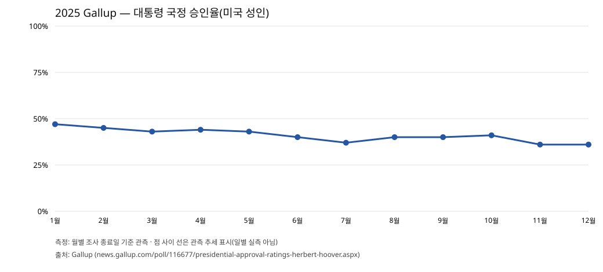

*그림 1. Gallup 2025 월간 국정승인 시계열. 출처: [W1 복원](W1_SURVEY_TIMELINE.md), [CSV](assets/W1-VIS-F01_gallup_2025_approval.csv). 기관 사이 값을 하나의 수열로 접합하지 않았다.*

Pew의 미국 성인 승인율은 2025년 2월 47%, 2026년 1월 37%, 2026년 10월 30%로, Gallup과 다른 시점·문항 조사설계에서도 큰 방향이 유사하다. 2026년 4월과 7월에는 약 34% 수준으로 관측됐기에 특정 사건 직후의 매주 감소폭까지 식별되지는 않는다. Reuters/Ipsos 역시 2026년 1월 대표 관측 약 38%, 7월 약 37%, 10월 약 32%라는 방향을 보여준다. 이 세 기관의 각 수치를 서로 다른 기관 사이의 세밀한 월간 변화량으로 계산하지 않는다.

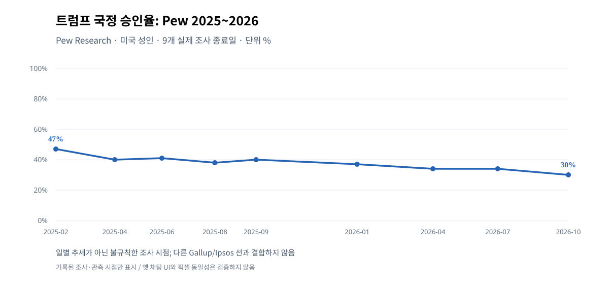

*그림 2. Pew 실제 필드 종료일 기준 국정승인 시계열. 출처: [W1 조사](W1_SURVEY_TIMELINE.md), [CSV](assets/W1-VIS-F02_pew_2025_2026_approval.csv).*

*그림 3. Reuters/Ipsos 월별 대표 조사시점. 단일 동질 월평균으로 계산한 그래프가 아니다. [W1 3차 보완](W1_2026_IPSOS_MONTHLY_RECHECK.md), [CSV](assets/W1-VIS-F03_reuters_ipsos_approval_2026.csv).*

### 2.2 지지율 이외의 평가: 정책 판단 신뢰

Pew가 2024년 11월부터 비교한 '트럼프가 좋은 결정을 내릴 것으로 신뢰한다'는 질문에서 경제 59%→2026년 10월 35%, 외교 53%→35%, 이민 53%→41%로 내려갔다. 이는 대통령의 국정승인율이 아니라 개별 분야의 **판단능력 신뢰**에 대한 질문이다. 세 분야의 하락폭을 더해 전체 국정승인 하락폭이라고 표현할 수 없다.

*그림 4. Pew 동일 질문 5개 조사 시점의 경제·외교·이민 판단 신뢰. [원표 추적](W3_CHINA_UKRAINE_NATO_20261012.md) · [CSV](assets/W3_W4-VIS-F01_pew_policy_confidence_2024_2026.csv).*

### 2.3 전통 지지층도 초기만큼 우호적이지 않다

특히 2024년 트럼프 투표자 집단의 국정승인이 2025년 2월 95%에서 2026년 10월 67%로 낮아졌다는 것은 단순히 민주당 성향 응답자가 대통령을 싫어한다는 설명을 넘어선다. 그럼에도 67%는 여전히 과반이고, 이 집단의 하원 공화당 후보 선택은 77%다. 따라서 "트럼프의 대선 지지층 대부분이 완전히 민주당으로 돌아섰다"는 서술은 자료와 충돌한다. 같은 기관의 과거 투표 집단이라도 동일 개인 전체를 장기간 고정 추적한 인과 패널은 아니다.

*그림 5. 2024 검증 투표층의 국정평가 비교. 원자료와 정의: [W5](W5_2024_VOTER_COALITIONS_AND_TURNOUT_20261012.md) · [CSV](assets/E2-VIS-F01_trump_2024_voters_approval.csv).*

**소결.** 장기 하락의 존재는 복수 기관과 과거 트럼프 지지층 안에서 뒷받침된다. 그러나 그 하락의 정확한 기여 원인이나 투표 선택의 전환량은 아직 특정되지 않았다. 다음 장부터는 이러한 평가가 형성된 정책 환경과 반례를 분리해 살핀다.

## 3. 경제·관세·생활비: 체감 불만과 실측의 교차 검증

### 3.1 공식 가격 변화와 가계 부담

BLS CPI-U는 2025~2026년 소비자물가 수준 변화의 핵심 자료다. W2 조사에서 2026년 4월 CPI 전년동월 상승률은 3.8%, 5월 4.2%, 8월 3.4%로 나타났다. 그러나 2025년 10월 공식 CPI 수치가 정부 운영 중단의 영향으로 결측인 기간이 있으므로, 표·차트는 그 지점을 **0% 또는 보간된 실측치로 표시하지 않았다**. 발표시점·개정·전년동월 비교 조건에 따라 정확한 계산 가능한 월이 제한된다.

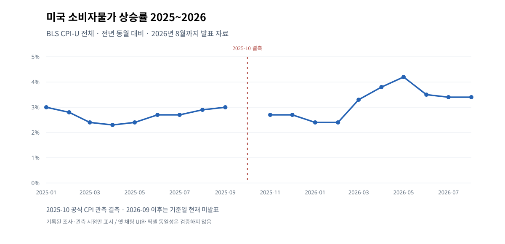

*그림 6. BLS CPI 전년동월비 관측 및 2025년 10월 공식 결측. [W2 원자료](W2_ECONOMIC_TIMELINE.md) · [CSV](assets/W2-VIS-F01_cpi_2025_2026.csv).*

EIA의 전국 일반 휘발유 주간 소매평균은 이란 군사작전 개전 직전 2026년 2월 23일 갤런당 2.937달러, 5월 11일 4.500달러, 10월 5일 4.354달러로 기록됐다. 2월 말 대비 10월 초의 가격 수준 차이는 큰 폭이지만, 이 차액을 전부 이란 전쟁이나 트럼프 정책의 직접 효과라고 볼 수 없다. 미국 국내 정제, 국제 공급, 운송, 계절성, 기타 정책도 함께 움직인다.

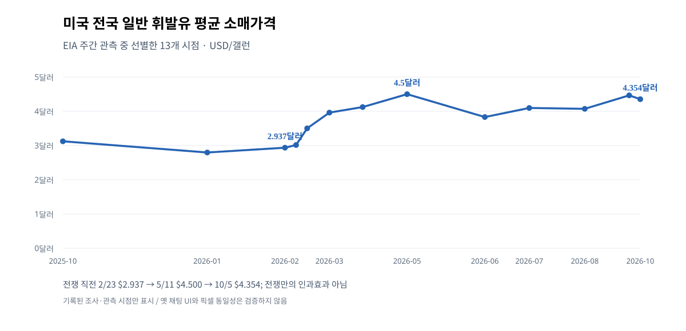

*그림 7. EIA 선정 주간 관측과 날짜별 가격. [W2 원자료](W2_ECONOMIC_TIMELINE.md) · [CSV](assets/W2-VIS-F02_gasoline_2025_2026.csv).*

물가와 주거비 역시 서로 다른 측정이 필요하다. CPI 주거 구성항목의 임대료/자가주거비와 신규 주택 구매자의 모기지 금리 부담은 같은 숫자가 아니다. 2026년 10월 무렵 약 7.4%의 30년 고정 모기지 금리 관측을 소비자물가지수의 주거상승률과 동일시하면 실제 구매자 비용을 제대로 설명하지 못한다.

### 3.2 경제 전체가 붕괴했다는 주장은 증거와 다르다

체감 생활비 악화가 곧바로 모든 거시지표의 일제 붕괴를 뜻하지 않는다. W2의 BEA 근거에 따르면 2026년 8월 실질 가처분소득은 전월 대비 약 0.0%였지만 실질 개인소비지출은 약 0.6% 증가했다. 고용 측면에서도 2026년 9월 제조업 신규고용은 약 9천명 증가했고 2025년 12월 저점 대비 제조업 고용은 약 7만2천명 회복한 것으로 기록된다. 반면 일부 실질 시간임금과 신규 고용 흐름은 약했다. 이 자료들은 **가계 부담이 없다는 반증도, 생산·고용의 전면 붕괴를 입증하는 증거도 아니다.**

이는 정책평가 연구에서 중요한 균형점이다. 유권자가 휘발유·식료품·주거비를 부정적으로 평가하는 것과 모든 생산/소득/소비가 마이너스로 움직였다는 주장은 다르다. 정치적 불만의 설명력을 지키려면 실제 경제가 혼합 신호를 보인다는 반례도 함께 설명해야 한다. [W2 소득·주거·제조업 세부](W2_INCOME_HOUSING_MANUFACTURING_RECHECK.md).

### 3.3 관세는 비용 전달 경로지만 전체 인플레이션을 독점하지 않는다

2025년 4월 2일 상호관세 행정명령(EO 14257)과 4월 9일 수정명령으로 미국 통상정책은 급격히 달라졌다. 이후 협상·유예와 여러 법적 권한의 구성이 변경돼 초기 발표 세율을 전체 기간의 실제 관세율로 사용할 수 없다. 뉴욕 연준의 관세 노출 소비재 가격 연구는 일부 수입 연관 상품의 가격수준에 관세 비용이 전달된다는 정량적 메커니즘을 제공한다. 하지만 그 연구는 미국 전체 CPI 상승의 관세 몫이나 트럼프 지지율 감소의 관세 몫을 곧바로 계량한 것이 아니다.

2026년 2월 20일 연방대법원은 *Learning Resources v. Trump* 사건에서 IEEPA가 해당 방식의 광범위 관세 부과 권한을 부여하지 않는다고 판단했다. 이는 다른 법률에 의한 모든 관세가 동시에 폐지됐다는 뜻이 아니다. 관세의 정치적 비판과 실제 소비자 가격 부담, 권한의 법적 범위를 함께 다뤄야 한다. [백악관 2025-04 행정명령](https://www.whitehouse.gov/presidential-actions/2025/04/regulating-imports-with-a-reciprocal-tariff-to-rectify-trade-practices-that-contribute-to-large-and-persistent-annual-united-states-goods-trade-deficits/) · [W3/W7 사건 감사](W3_W7_EVENT_CAUSAL_REVIEW.md).

### 3.4 실측 경제와 대통령에 대한 책임 귀속

이 부분에서 W7이 추가로 검증한 Pew 수치가 중요해진다. 트럼프 경제정책이 경제를 '더 나쁘게 만들었다'는 응답은 미국 성인 전체에서 2025년 9월 53%, 2026년 1월 52%, 7월 60%, 10월 65%였다. 같은 질문에서 개선시켰다는 응답은 24%, 28%, 20%, 19%였다. 경제 악화 인식이 직선적으로만 오르지는 않지만 2026년 하반기에는 분명히 악화했다.

공화당·공화 성향층에서는 악화 평가 2025년 9월 19%→2026년 10월 35%, 개선 평가 47%→39%로 바뀌었다. 2026년 1월 공화 성향 개선 평가는 57%였다는 점을 보면 우호층 내부 평가 역시 고정돼 있지 않았다. 다만 같은 정당 범주의 서로 다른 시점 표본을 동일 인물의 선택 변화로 단정할 수는 없다. 이는 **정책 책임에 대한 인식이 변화했다는 조사 결과이지, 객관적 GDP의 정책 인과효과를 직접 측정한 자료는 아니다.**

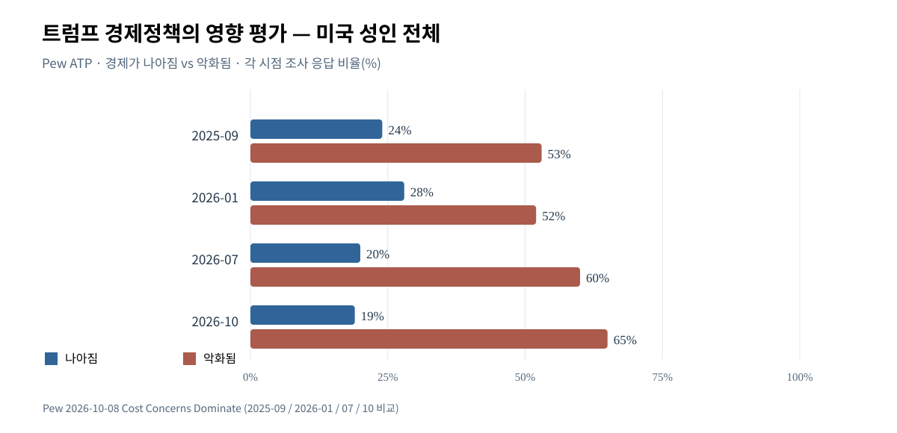

*그림 8. 경제정책으로 경제가 개선/악화되었다는 미국 성인 판단. [W7 재검증](W7_FULL_INTEGRATED_CAUSAL_AND_ELECTORAL_REVIEW_20261012.md) · [CSV](assets/W7-VIS-F02_pew_economic_policy_attribution_all_adults_2025_2026.csv).*

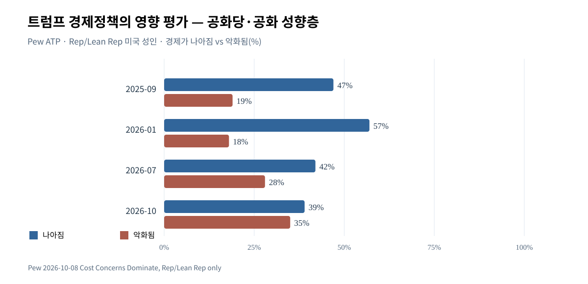

*그림 9. 공화당·공화 성향층의 같은 질문. 전체 성인 비율과 다른 하위집단 단면. [CSV](assets/W7-VIS-F03_pew_economic_policy_attribution_republicans_2025_2026.csv).*

Pew 등록유권자 중 경제를 중간선거에 '매우 중요'하다고 보는 응답은 84%였다. 하지만 이는 여러 의제를 각각 평가한 복수 중요도 질문이다. 다른 기관의 '오직 하나의 최우선 문제' 비율과 같은 분모·문항으로 평균내서는 안 된다. [Pew 경제 여론 원문](https://www.pewresearch.org/politics/2026/10/08/cost-concerns-dominate-as-publics-economic-ratings-turn-more-negative/).

**소결.** 생활비와 경제 책임 인식은 트럼프 국정평가 악화를 설명하는 가장 직접적이고 폭넓은 근거 묶음이다. 그렇지만 실물통계의 상충 신호와 전쟁·금리·관세 등 원인이 얽혀 있어, '경제가 지지율을 정확히 몇 %포인트 떨어뜨렸다'는 숫자까지 만들 수는 없다.

## 4. 이란 전쟁과 에너지 가격: 새 충격과 오래된 불만

### 4.1 전쟁은 언제 불만의 중심으로 들어왔는가

2026년 2월 28일 미국·이스라엘의 대이란 군사작전이 시작됐다. 사건의 시계열상 중요성은 명백하지만, 국정승인율의 모든 장기 하락을 이 사건에 설명시키면 시작점이 맞지 않는다. Gallup의 2025년 하락과 Pew 2026년 1월의 37% 승인은 개전 이전의 관측이다. 따라서 가능한 설명은 '전쟁이 장기 하락을 새로 만들어냈다'가 아니라 **이미 약해진 경제·외교 신뢰에 전쟁·에너지 충격이 추가됐다**는 쪽이다.

개전 전 EIA 주유소 가격은 2월 23일 2.937달러였다. 3월 9일 3.502달러, 5월 11일 4.500달러로 높아졌다. 이런 시간상 일치는 국제 유가·해상운송·정제 및 보험비용이라는 전달경로와 부합한다. 그러나 국제 공급, 계절성, 정제 설비, 수급 대응이 동시 변동했고 **'전쟁이 없었다면 휘발유 가격은 얼마였을 것인가'**라는 독립 반사실 경로는 이 연구에서 확보하지 못했다.

### 4.2 전쟁에 대한 평가는 어느 정도로 나빠졌는가

Pew의 동일한 전쟁 대응 승인 질문에서 미국 성인 전체 승인율은 2026년 3월 37%, 10월 33%였다. 같은 기간 반대는 61%에서 65%로 증가했다. 공화당·공화 성향층 승인율은 69%에서 63%로 떨어졌고, 민주당·민주 성향층에서는 9%에서 9%로 큰 차이가 없었다. 서로 다른 시점·표본 조사이므로 같은 개인 6%가 마음을 바꿨다고까지 말할 수는 없지만, **전쟁 대응에 대한 공화당 성향층 내부의 지지가 전체적으로 약화**한 관측이다.

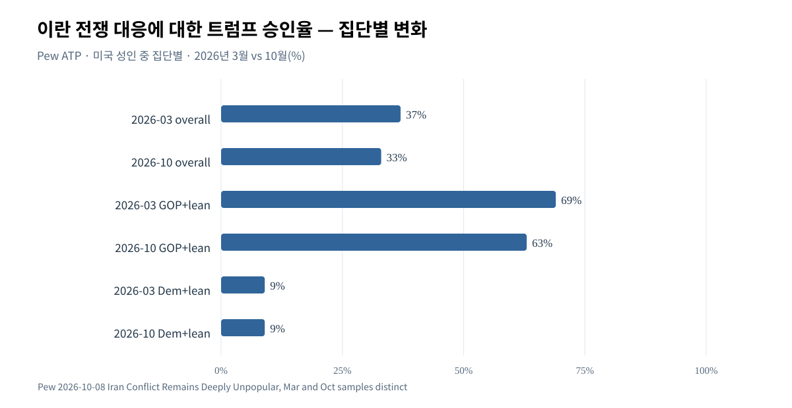

*그림 10. 이란 전쟁 대응 승인 2026년 3월·10월, 미국 성인 및 당파 하위집단. 대통령 **전체 국정승인**과 다른 질문. [CSV](assets/W7-VIS-F04_pew_iran_war_handling_approval_mar_oct_2026.csv), [Pew 연구](https://www.pewresearch.org/short-reads/2026/10/08/iran-conflict-remains-deeply-unpopular-as-many-americans-expect-it-to-go-on-for-months/).*

2026년 10월 응답자 77%는 미국의 이란 관련 군사작전이 향후 최소 6개월 이상 지속될 것으로 예상했다. 구체적으로 6~12개월 30%, 1년을 초과 47%로 보고됐다. **이것은 대중의 기간 전망**이지 실제 전쟁이 그만큼 지속될 것이라는 확정 사실은 아니다. 전쟁의 정치적 부담은 전황뿐 아니라 불확실성이 오래 갈 것이라는 기대에서도 생길 수 있다.

### 4.3 전쟁 중요성과 생활비 경로의 분리

Chicago Council의 2026년 7월 조사에서는 응답자 37%가 물가·생활비를 **단일 최우선 중간선거 문제**로 답했지만, 이란 전쟁 자체를 단일 최우선이라고 답한 응답자는 약 2%였다. 반면 '이란 전쟁이 생활비에 부정적 영향을 준다'는 별도 질문에서는 86%, 관세가 생활비에 부정적이라는 질문에서는 81%였다. 전쟁 그 자체를 유권자가 우선순위 첫 번째에 두지 않더라도 **전쟁의 가격 파급을 통해 경제의 중요성을 체감**할 수 있다는 해석과 맞는다. 이는 미국인이 인식한 영향이지 에너지 실측의 전쟁 기여율이 아니다.

*그림 11. Reuters/Ipsos의 이란 전쟁 이슈 현저성(각 시점). [W7 선행 경쟁가설](W7_ALTERNATIVE_EXPLANATIONS_ROUND3.md), [CSV](assets/W7-VIS-F01_war_issue_salience_2026.csv).*

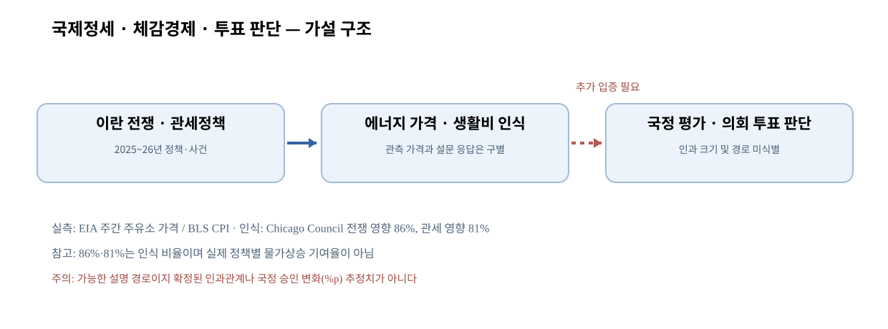

*그림 12. 정책·전쟁 → 가격과 영향 인식 → 국정평가·투표판단의 **가설적 전달경로**. 점선 연결은 직접적인 독립 인과효과가 검증되지 않았다는 표시다. [W3/W7 원문](W3_W7_EVENT_CAUSAL_REVIEW.md).*

선거를 해석할 때 경제84%·전쟁2%와 같은 숫자를 서로 반대되는 것으로 놓는 것도 오류다. 전자는 경제에 대한 **복수 주제 중요도 질문**, 후자는 단일 최우선 쟁점이며 시점과 조사기관까지 다르다. W3는 전달경로의 성립 가능성과 여론 인식, 실제 가격의 시간적 정합성은 인정하되 **전쟁만의 인과 비중**은 보류했다.

**소결.** 전쟁은 2026년 국정운영 불만에 추가되는 신뢰할 만한 설명경로다. 그러나 이미 진행되던 2025년 하락을 소급해 설명하거나 휘발유 가격 상승 전체를 전쟁 탓으로 계량할 근거는 없다.

## 5. 중국·우크라이나·NATO: 복합 외교 평가

### 5.1 중국에 대한 인식과 트럼프의 대중국 대응은 다르다

미·중 무역관계의 2025년 제네바 공동성명, 스톡홀름 유예 연장, 2026년 정상회담 이후의 백악관 성과 발표는 정책 사건으로 기록돼 있다. 2025년 5월 제네바 성명은 상호관세 일부의 24%포인트를 90일 유예하고 10%포인트 부분을 유지하는 내용이었으며, 이후 유예가 연장됐다. 그러나 이것이 Section 301·232 같은 모든 기존 관세를 해제하거나 장기 경쟁을 종식했다는 뜻은 아니다. 2026년 정상회담의 성과를 다룬 백악관 발표는 **당사자인 행정부의 평가**이므로 중국 측 이행과 경제적 실효까지 독립적으로 확인한 것과 다르다.

Pew 2026년 3월 조사에서 중국에 대한 미국 성인의 호감은 27%로 2025년의 21%보다 높아졌다. 동시에 트럼프가 대중국 관계에서 좋은 결정을 내릴 것으로 신뢰한다는 응답은 2025년 8월 45%에서 2026년 3월 39%로 떨어졌다. **중국이라는 국가에 대한 이미지와 자국 대통령의 대중국 정책 신뢰는 같은 것이 아니다.** 따라서 '미국인이 중국을 더 싫어하게 돼 트럼프 평가가 나빠졌다'는 일원적 설명은 실제 조사와 맞지 않는다.

### 5.2 우크라이나 정책, 러시아, 휴전 제안의 미확정성

Pew의 트럼프 우크라이나 대응 결정 신뢰는 2025년 8월 40%에서 2026년 3월 32%였다. 같은 조사에서 미국의 우크라이나 지원이 '너무 많다' 20%, '부족하다' 29%, '적당하다' 26%로 나뉘었다. 민주 성향층은 지원 부족 평가가 50%, 공화 성향층은 11%였다. 이 결과는 '미국인 전체가 우크라이나 지원 중단을 원한다'는 주장과 양립하지 않는다.

러시아 비호감 응답은 83%였고, 공화당 성향층 중 러시아를 적국으로 평가하는 비중 역시 이전보다 높아졌다는 조사 결과가 있다. 특정 후보·정당의 외교발언을 미국 사회의 대러시아 감정 전체로 일반화할 수 없는 이유다. 2025년 3월의 미·우크라이나 공동성명은 우크라이나 측의 조건부 휴전 수용과 미국의 지원 재개에 관한 내용이었지만 **러시아의 실제 휴전 이행**을 증명하지 않았다.

2026년 10월 11일 보도된 러시아산 경유 거래와 에너지 관련 휴전 제안은 더욱 주의가 필요하다. 당시 우크라이나 측은 세부사항 확인을 기다렸고 미국 내 법적·정치적 반론도 제기됐다. 해당 조치의 양측 공식 합의, 실제 집행 및 그 이후의 여론 변화가 확인되지 않았으므로 **완료된 외교 성과나 중간선거의 확정적 변화 요인**으로 집계하지 않는다. [W3 외교 조사 상세](W3_CHINA_UKRAINE_NATO_20261012.md).

### 5.3 NATO는 정책적 성과와 대중의 평가가 엇갈린다

2025년 6월 NATO 헤이그 선언에서 회원국은 2035년까지 GDP의 5% 수준을 핵심 국방지출과 관련 안보지출 목표로 설정했다. 핵심 방위 3.5%와 광의의 안보 관련 지출 최대 1.5%의 구성이다. 합의 자체는 검증 가능한 외교적 사건이나, 목표가 **2035년까지의 약속**이라는 점을 분명히 해야 한다. 실제로 모든 나라가 현재 5%를 지출했다고 서술할 수 없다.

Pew 2026년 3월 조사에서 NATO 회원국 지위가 미국에 이롭다는 미국 성인의 응답은 59%였다. 민주·민주 성향층 82%, 공화·공화 성향층 38%로 격차가 컸다. 공화당 성향층의 트럼프 NATO 판단 신뢰와 NATO 회원국 지위에 대한 유익 평가 역시 서로 다른 질문이다. 공화당 성향의 트럼프 판단 신뢰가 상대적으로 높으면서 동시에 NATO 가입의 이익을 낮게 평가하는 것은 설문상 모순이 아니다.

*그림 13. Pew 미국 성인 전체와 양당 성향집단의 NATO 가입 이익 평가. [CSV](assets/W3-VIS-F04_pew_nato_membership_benefit_2026.csv), [Pew 관련 설명](https://www.pewresearch.org/short-reads/2026/04/06/republicans-have-become-less-likely-to-say-nato-membership-benefits-the-us/).*

외교 판단 신뢰 하락은 대통령의 전반적 평가 악화와 나란히 놓일 수 있는 중요 설명영역이지만, 여러 사건의 효과와 당파적 인식이 얽혀 있다는 점을 넘어 독립적인 지지율 하락분을 계량하기 어렵다. 대통령의 외교적 결정이 성공 또는 실패였다는 판단과 실제 중간선거 득표는 또 한 단계 더 떨어져 있다.

**소결.** 미국 외교여론은 단순한 '전쟁 찬성·반대' 또는 '트럼프 외교 성공·실패'라는 이분법에 들어맞지 않는다. 중국 호감 상승, 우크라이나 지원 평가의 분열, NATO의 당파적 격차는 외교 요인의 중요성을 보여주는 동시에 강한 단일원인 설명을 제한한다.

## 6. 이민 집행·사법·재정·의료: 국내정치의 경쟁 설명

### 6.1 강경 이민정책의 목표와 ICE 단속수단에 대한 응답

2025년 1월 20일 행정명령 14159 등으로 강화된 이민집행 정책을 이해하려면, 불법체류자 추방의 **목표**, 집행 규모의 **적정성**, ICE의 **전술**, 기관의 **폐지**를 별개로 물어야 한다.

2026년 2월 ABC/Washington Post/Ipsos 조사에서 불법체류자 전원 추방을 지지한다는 응답은 50%, 반대 48%였다. 동시에 ICE의 현 단속 전술에 반대한다는 응답은 62%(찬성 31%)였으며, ICE 자체 폐지에는 반대 50%, 지지 37%였다. 즉, **추방이라는 일반 목적에 일부 동의하는 유권자도 실제 집행 방식에는 반대하고 ICE 폐지를 원하지 않을 수 있다.** 이것은 같은 정책의 모순적인 태도라기보다 서로 다른 제도적 질문에 대한 응답이다.

Pew의 동일 질문 '트럼프 행정부가 추방을 지나치게 많이 한다'에는 2025년 2월 44%, 10월 53%, 2026년 4월 52%가 그렇다고 답했다. 2026년 4월 당파별 수치는 공화·공화 성향 19%, 민주·민주 성향 84%였다. 추방 집행에 대한 반감이 커져도 공화당 지지층의 강경 이민정책 선호는 상당 부분 남아 있다.

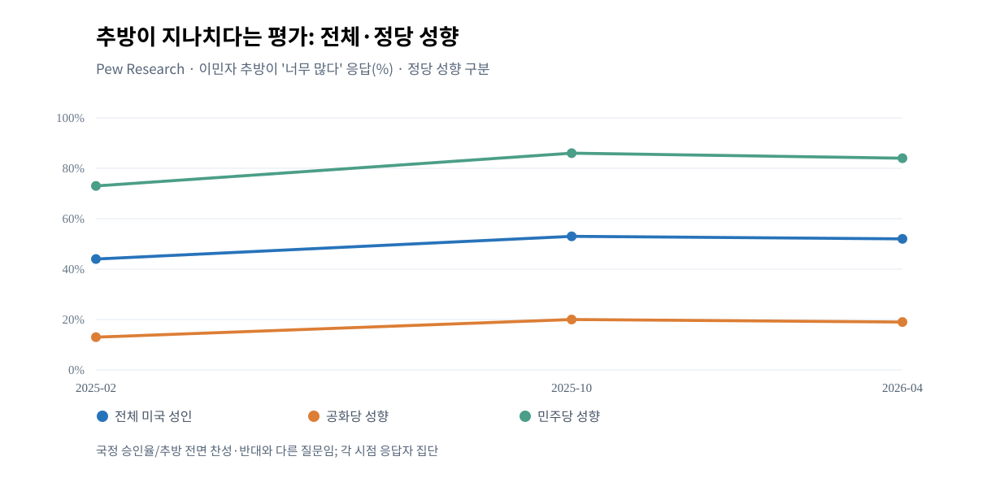

*그림 14. 2025~2026년 Pew 동일 문항의 전체·당파별 응답. [W4 조사](W4_IMMIGRATION_JUDICIARY_FISCAL_HEALTH_20261012.md) · [CSV](assets/W4-VIS-F02_pew_deportations_too_much_2025_2026.csv).*

정치적으로도 이 구분이 중요하다. Cook의 37개 경합 하원 선거구 설문에서는 경제·인플레이션·관세·부패 대응 정당 신뢰가 민주당에 유리했지만, 이민 대응 신뢰는 공화당이 5%포인트 앞섰다. 그러므로 '이민에 대한 비판이 커졌다 → 공화당의 이민 쟁점 경쟁력은 소멸했다'는 결론은 지지되지 않는다. 텍사스 국경지역의 인력 부족과 일부 법원 제동 사례는 집행정책의 지역 비용과 법적 긴장을 보여주지만 무작위 전국 경제인과를 증명한 자료는 아니다.

### 6.2 사법부·대통령 사익·민주주의 신뢰

2026년 2월 IEEPA 관세 권한 판결은 행정부의 특정 권한 행사에 실질적인 법적 경계를 그었다. 하지만 그 판결 하나가 모든 관세 또는 모든 대통령 행정조치를 위헌으로 만든 것은 아니다. 2026년 10월 유권자명부와 SAVE 데이터베이스 관련 연방지법 판결도 선거관리 갈등을 보여주는 사례로 기록됐으나, 판결 적용 범위·항소·집행정지의 후속 정본까지 포괄적으로 확인된 것은 아니다. 특정 소송 제기나 판결을 광범위한 선거부정의 실증으로 치환해서는 안 된다.

Pew 2026년 10월 미국 성인 69%는 트럼프가 공식 결정에서 개인 사업 이해관계를 분리할 것이라고 신뢰하지 않는다고 답했다. 공화 성향층에서도 같은 불신이 42%로 존재하나, 민주 성향층에서는 92%였다. 이는 대통령에 대한 윤리·제도적 **신뢰 설문**이지 개별 위법행위에 대한 재판상의 유죄 인정이 아니다.

중간선거에서 민주주의의 미래를 '매우 중요'라고 꼽은 등록유권자는 73%였다. 민주당 후보 지지층 85%, 공화당 후보 지지층 69%라는 당파별 응답은 **양당 유권자 모두 민주주의를 중요한 의제로 인식하지만 서로 같은 위협을 떠올린다는 뜻은 아니다.** 민주주의 의제 중요도 수치를 전부 특정 후보를 반대하는 표로 배분할 수는 없다.

### 6.3 세제·재정법과 미래 보건의료 부담

2025년 7월 4일 성립한 Public Law 119-21(이른바 One Big Beautiful Bill Act)은 세제 조정, Medicaid 및 SNAP 요건 변경, 국방·이민 관련 재원 등 복수의 비용·편익을 가진 정책이다. CBO의 2026년 2월 자료는 해당 조정법이 특정 기준선에 비해 2025~2034년 누적 적자를 약 **4.2조 달러 증가**시킬 것으로 전망했다. 2026~2035년 Medicaid 지출 약 **1.2조 달러 감소**, 2034년 무보험자 약 **750만명 증가** 역시 당시 모델·기간·기준선에 의존한 **미래 전망**이다. 2026년에 750만명이 실제로 보험을 잃었다는 실측값으로 사용할 수 없다. Medicaid 등록자 감소와 무보험자 증가의 수치는 서로 다른 정의와 분모도 갖는다.

법률이 완전히 무효하거나 실현된 결과만으로 평가되는 것도 아니다. 감세·지출 재배분을 긍정적으로 평가하는 집단이 있고, KFF의 2025년 7월 조사에서는 공화당 응답자들의 해당 법안 호감이 78%였다. 그러나 전체 비호감 응답은 63%였다. 정책의 당파적 수용 차이는 크며, 미래 재정·보장 변화를 특정 연도의 현재 피해 규모로 단정하지 않는 것이 핵심이다. [CBO 2026 예산·경제 전망](https://www.cbo.gov/publication/62105) · [W4 상세](W4_IMMIGRATION_JUDICIARY_FISCAL_HEALTH_20261012.md).

### 6.4 의료비 정책 신뢰는 민주당에 유리하지만 모든 의료 의제에서 그런 것은 아니다

KFF의 2026년 9월 등록유권자 조사에서 의료비 문제를 더 잘 처리할 것이라는 정당 신뢰는 민주당 42%, 공화당 22%였다. 같은 기관의 4월 조사는 37% 대 26%였으므로 그 질문에 관한 민주당 상대우위가 커졌다. 의료비는 생활비 전체의 일부분이지만 보험·약값·의료 보장이라는 직접적인 가계 부담을 연결한다.

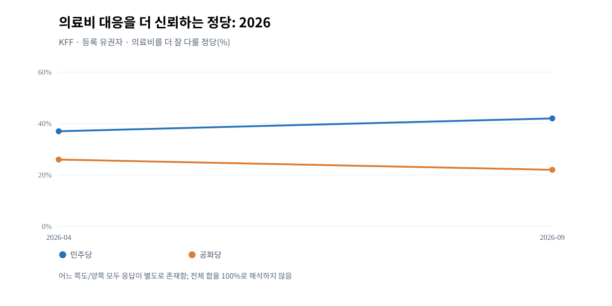

*그림 15. 2026년 4월·9월 KFF 등록유권자 응답. [CSV](assets/W4-VIS-F03_kff_healthcare_party_trust_2026.csv), [KFF 발표](https://www.kff.org/public-opinion/kff-health-tracking-poll-health-care-issues-in-the-lead-up-to-the-2026-midterm-election/).*

반례도 있다. KFF의 다른 문항에서는 공화당이 의료 낭비·부정수급 대응에서 민주당보다 높은 신뢰를 받은 경우가 있다. 따라서 '의료 문제 전체에서 유권자가 민주당 정책을 절대적으로 지지한다'고 서술할 수 없다. 의료비에서의 상대적 신뢰가 실제 투표로 이어지는 정도도 조사 설문만으로 식별되지 않는다.

### 6.5 의제가 여러 개라는 사실의 의미

*그림 16. Pew의 등록유권자 대상 각 쟁점별 '매우 중요' 응답. 경제84%, 민주주의73%, 의료68%, 이민59%, 외교57% 등. 여러 항목을 동시에 중요하다고 답할 수 있으며 하나의 100% 분할 원형그래프가 아니다. [CSV](assets/E6-VIS-F01_midterm_issue_importance_2026.csv).*

경제는 공동의 접점이지만 이민 집행, 민주주의, 의료 정책, 국제정세 역시 유권자의 판단에 영향을 줄 수 있는 경쟁 영역이다. 같은 사람이 복수의 문제를 우려할 수 있고, 대통령을 지지하거나 비판하는 정치정체성이 여러 문제에 대한 응답을 동시에 좌우할 수 있다. 이것이 여러 쟁점의 '중요도'를 합쳐 실제 국정지지율 하락의 원인별 몫으로 분배할 수 없는 이유다.

**소결.** 국내정책은 단순히 경제 설명의 부속물이 아니다. 특히 추방 목표와 ICE 전술 반발, 의료비 민주당 우위와 정책 유형별 반례, 미래 CBO 전망과 현재 실측의 차이는 최종 선거 판단에서 반드시 남겨야 할 독립적인 근거다.

## 7. 2024년 투표연합은 2026년에 어떻게 달라졌는가

### 7.1 대통령을 싫어지는 것과 상대당 하원 후보를 선택하는 것은 다르다

2026년 중간선거를 읽는 가장 중요한 오류 중 하나는 대통령 국정지지율 하락을 민주당의 자동 득표 증가로 옮기는 것이다. Pew는 2024년 대선에 투표했는지를 유권자명부로 검증하고 그 선거에서 어느 후보를 골랐는지는 대선 직후의 설문 응답을 이용했다. 이 집단의 2026년 하원 선택은 아직 **사전 후보 선호**이지 11월 실제 투표기록이 아니다.

| 2024년 대선 기준집단(2026년 등록유권자) | 2026 공화 하원 | 민주 하원 | 기타 | 미결정 |
|---|---:|---:|---:|---:|
| 트럼프 투표층 | **77%** | 5% | 5% | 13% |
| 해리스 투표층 | 3% | **87%** | 3% | 7% |
| 2024년 비투표 또는 당시 비적격 집단 | 26% | 39% | 6% | **29%** |

이 비교는 세 가지를 말해준다. 첫째 트럼프를 2024년에 지지한 사람 중 2026년에도 공화당 하원 후보를 선택한다고 답한 비중은 77%로 높다. 둘째 23%가 공화당 후보 선택을 확답하지 않았더라도 그 중 민주당을 선택한다고 답한 비중은 5%뿐이다. 나머지는 다른 후보 또는 미결정으로 분산돼 있다. 셋째 2024년에 투표하지 않았거나 그해 적격이 아니었던 등록유권자 집단에서는 미결정 비율이 29%로 특히 높다. 이 집단을 민주당이 이미 확보한 표로 계산하는 것도 부정확하다.

*그림 17. Pew의 과거 검증 투표자 집단별 사전 하원 선호. 한 집단의 선택 분포이지 개인의 2024→2026 **실제 득표 전환** 자료가 아니다. [W5 상세](W5_2024_VOTER_COALITIONS_AND_TURNOUT_20261012.md) · [CSV](assets/W5-VIS-F01_2024_coalitions_2026_house.csv).*

### 7.2 자기 진영에 실망한 유권자는 어디로 가는가

Pew는 각 2024년 대선 후보 지지층 중 현재 자당을 부정적으로 보는 약 25% 집단도 구분했다. 트럼프 투표층에서 현재 공화당에 비호감인 집단은 하원 공화당 후보 49%, 민주당 12%, 기타 14%, 미결정 25%였다. 해리스 투표층에서 현재 민주당에 비호감인 집단은 민주당 후보 73%, 공화당 8%, 기타 5%, 미결정 14%였다.

*그림 18. 불만층을 추출한 Pew 하위집단. 소표본으로 1~3%포인트의 격차까지 과도하게 해석하지 않는다. [CSV](assets/W5-VIS-F02_disaffected_2024_voters_2026_house.csv).*

불만이 같은 크기더라도 두 진영의 선거 반응은 동일하지 않았다. 자기 정당에 실망한 트럼프 지지자는 공화당 선택 자체가 줄어들고 미결정·기타가 커지는 반면, 해리스 지지자 중 민주당에 불만인 집단은 민주당 후보 선택을 더 많이 유지했다. 다만 어느 집단이 최종적으로 투표를 포기하는지, 남은 미결정자가 어느 당으로 정리되는지는 미래의 일이다.

각 2024년 지지집단 안에서 자기 정당을 비호감으로 평가한 사람 중 이번 선거가 '정말 중요하다'고 답한 비율도 트럼프 지지층 36%, 해리스 지지층 65%로 달랐다. 이는 참여 의욕·동원 측면의 잠재적 비대칭을 보여준다. 그러나 설문상의 중요도는 선거일 출석기록과 동일하지 않다.

### 7.3 성별·연령·인종·학력과 무당파

Pew의 전국 등록유권자 하원 후보 선호에서 남성은 민주42·공화42로 같고 여성은 민주45·공화31이었다. 백인 비히스패닉에서는 민주37·공화44, 히스패닉 전체는 민주51·공화24, 흑인 비히스패닉은 민주70·공화7이었다. 만 18~29세는 민주51·공화23, 만 50~64세는 민주39·공화45였다. 대학원 학위 집단은 민주58·공화30이지만 고졸 이하에서는 민주35·공화39로 나타났다.

이 비교는 우선적인 **정당 후보 선호의 구성과 격차**를 보여준다. 2024년에 트럼프에게 투표한 '히스패닉'의 실제 2026 민주당 전환율로 다시 해석해서는 안 된다. 히스패닉 전체 등록유권자와 히스패닉 트럼프 2024 투표자는 서로 다른 집단이다. 아시아계 조사도 영어로 응답 가능한 집단에 관한 대표성 등 별도의 한계가 있다.

정당 무소속/기타 식별 집단은 민주40·공화24·기타8·미결정 약27이었다. 반면 공화당 성향 무당파는 공화53·민주9·기타9·미결정28, 민주당 성향 무당파는 민주72·공화3·기타6·미결정19였다. 따라서 '무당파'라는 한 묶음으로 실제 공화성향·민주성향 집단을 취급하면 하원 지지의 큰 내부 차이를 놓친다. [Pew 인구집단별 상세](https://www.pewresearch.org/politics/2026/10/08/midterm-vote-preferences-by-race-and-ethnicity-age-and-other-demographics/).

### 7.4 강한 민주당 투표 의욕을 어떻게 해석할 것인가

Pew 등록유권자의 하원 민주당 후보 지지자 중 '투표할 의욕이 극도로 높다'는 응답은 63%, 공화당 후보 지지자 46%였다. 선거를 많이 생각한다는 응답은 민주50·공화36, 어느 정당이 이기느냐가 매우 중요하다는 비율은 민주78·공화69였다. Reuters/Ipsos의 별도 문항에서도 2024년 해리스 투표층 48%, 트럼프 투표층 30%가 매우 열성적으로 투표하겠다고 답했다. 이는 두 기관의 문항과 표본을 합산할 수 없더라도 방향성에서는 비슷한 신호다.

*그림 19. Pew 하원 민주/공화 후보 지지층별 높은 동기·관심·정당승리 중요도. [CSV](assets/W5-VIS-F03_congressional_engagement_2026.csv).*

그러나 같은 Pew에서 2022년과 2024년 **실제로 둘 다 투표한 기록이 확인되는 등록유권자**의 현재 하원 선호는 민주47·공화41이었고, 단지 자신의 투표 의욕이 극도로 높다고 응답한 집단은 민주59·공화35였다. 두 집단의 지지 차이는 자기보고 의욕을 실제 참여 예측모형과 똑같이 취급할 수 없음을 보여준다.

### 7.5 대통령 반대투표와 민주당 후보 자체 지지

Pew 전국 등록유권자 44%는 2026년 의회표를 트럼프에 반대하는 뜻으로, 19%는 트럼프 지지의 뜻으로 설명했다. 민주당 하원 후보 지지자의 84%가 반트럼프 동기를 언급한 반면, 공화당 하원 후보 지지자 중 트럼프 지지 동기 응답은 48%이고 약 50%는 대통령과 무관하다고 답했다. 이 설문은 대통령 선거를 치르는 해가 아닌데도 대통령에 대한 정치적 태도가 의회선거 선택과 연결되어 있음을 보여준다.

그렇다고 전체 44%가 민주당의 모든 정책을 긍정적으로 지지한다거나, 44%가 실제 민주당 득표율이라고 단정할 수는 없다. 민주당 자체 호감도·정책 능력에 대한 평가는 10장에서 독립적으로 검토한다.

**소결.** 트럼프 지지층 내부의 불만은 실재하나 민주당으로의 직접 전향은 그보다 훨씬 적게 관측된다. 민주당의 실제 선거상 강점은 반트럼프 동기의 높은 현저성과 자당 하원 후보 지지층의 결집 가능성에 있지만, 참여가 얼마나 실현될지는 아직 모른다.

## 8. 실제 투표율의 역사와 여론조사 편향

### 8.1 2018년과 2022년: 무엇을 투표율이라고 부르는가

사용자 승인 추가조사 C의 핵심은 역사적 중간선거 참여를 **같은 지표 안에서** 비교하는 데 있다. 미국 인구조사국 CPS 조사에서 시민 투표연령인구(CVAP) 대비 중간선거 투표율은 2018년 53.4%, 2022년 52.2%였다. Pew가 공식 하원 개표 결과의 유효 하원 투표수와 투표적격인구(VEP)로 계산한 별도 지표는 2018년 48.1%, 2022년 45.1%다.

| 독립 측정계열 | 2018년 | 2022년 | 같은 계열 안에서의 변화 |
|---|---:|---:|---:|
| Census CPS 응답/시민 투표연령인구(CVAP) | 53.4% | 52.2% | -1.2%p |
| Pew 공식 하원 유효표수/투표적격인구(VEP) | 48.1% | 45.1% | -3.0%p |

서로 다른 분모·분자·통계방식의 수치를 한 선으로 연결하여 '투표율이 53.4에서 45.1로 급락했다'고 계산하는 것은 오류다. 역사 비교는 두 계열 모두 2018년보다 2022년의 참여가 낮았다는 방향을 보여주지만 크기를 하나로 만들지는 않는다.

*그림 20. 시민 투표연령인구 분모의 조사기반 참여율. [CSV](assets/W5C-VIS-F01_census_midterm_citizen_turnout_2018_2022.csv), [Census 발표](https://www.census.gov/newsroom/press-releases/2024/congressional-election-voting-report.html).*

*그림 21. 공식 하원 유효표수와 추정 투표적격인구 분모. [CSV](assets/W5C-VIS-F02_pew_house_vote_turnout_2018_2022.csv), [Pew 과거 비교](https://www.pewresearch.org/short-reads/2023/03/10/turnout-in-2022-house-midterms-declined-from-2018-high-final-official-returns-show/).*

조기투표의 비중은 2018년 37.8%에서 2022년 47.1%, 우편투표 비율은 23.1%에서 31.8%로 높아졌다고 Census는 설명한다. 그러나 **조기투표와 우편투표는 서로 배타적인 범주가 아니며**, 선거일 전 투표 비율이 상승했다고 최종 투표율도 그만큼 높아졌다고 계산할 수 없다. 2026년 현재 주별 조기투표 시스템·시작일·집계방식은 서로 달라 전국의 실제 최종 투표율을 이 자료만으로 만들 수 없다.

### 8.2 과거 실제 동원의 정당별 차이

Pew의 검증 투표자 연구에서는 2020년 트럼프 대선 투표자의 71%, 바이든 대선 투표자의 67%가 2022년 중간선거에 참여했다. 2022년 공화당의 전국 하원 투표상 우세는 상당 부분 정당 간 직접 전향보다는 **누가 실제 투표하러 나왔는가**라는 참여 구성과 관련되었다. 이는 2026년 민주당의 높은 설문 의욕이 강한 경쟁력의 신호일 수 있으면서도 선거일 실제 동원을 확인하기 전에는 결과 확정이 아니라는 역사적 반례다. 2020 Trump/Biden 투표층과 2024 Trump/Harris 투표층을 같은 인구집단으로 그대로 놓을 수도 없다. [Pew 2022 검증 투표 연구](https://www.pewresearch.org/politics/2023/07/12/republican-gains-in-2022-midterms-driven-mostly-by-turnout-advantage/).

### 8.3 과거 여론조사 오차는 어떻게 다루어야 하는가

사용자 승인 B 보완조사에서는 Pew의 2026년 9월 정치 가중치 방법론 연구를 독립적으로 확인했다. 2024년 전국 정치여론조사의 약 70%가 응답자의 정당이나 과거 투표에 관련된 정치적 가중치를 썼다. Pew 자체의 2020·2024 조사에 대한 후속 검토에서는 적절한 정치 가중치가 후보별 평균 오차를 대략 1~2%포인트, 후보 간 차이에 대한 오차를 약 2~3%포인트 줄일 수 있었다.

이는 **2026년 민주당 선호가 과장됐으므로 모든 조사에서 3%포인트를 공화당 쪽으로 옮겨야 한다는 근거가 아니다.** 가중치가 사용하는 변수·당파 분포의 안정성·명부 정보·응답방식이 서로 다르다. 같은 정당 안에서도 설문에 잘 응답하는 사람과 응답하지 않는 사람은 정치적 성향이 다를 수 있다. 정치 가중치를 쓰면 항상 정확해지는 것도 아니며, 오래된 정당 분포에 억지로 표본을 맞추면 새로운 오차를 만들 수 있다. [Pew 정치 가중치 연구](https://www.pewresearch.org/methods/2026/09/16/weighting-polls-on-party-affiliation-and-past-vote/) · [W6-B 분석](W6_B_POLL_ERROR_AND_METHOD_20261012.md).

### 8.4 같은 민주당 우세라도 서로 다른 조사 모집단

2026년 10월 Pew 전국 등록유권자의 하원 선호 민주44·공화36과 9월 Cook의 37개 경합 지역구 LV 민주49·공화47은 동시에 참일 수 있다. 앞의 조사는 등록유권자 전체, 뒤의 조사는 경쟁지역만 골라 투표가능성을 모델링한 표본이다. Cook 전체 묶음의 약 ±3.02%포인트 오차를 개별 선거구 하나의 결과에도 적용하면 안 된다. 후보 이름, 조사시점, 지역구 경계가 달라 동일한 민주당 우세가 '예측할 의석 순증'으로 이어지는 방식도 달라진다.

2026년 4월 Cook의 조사 묶음은 36개 지역구이고 9월은 37개 지역구였다. 표본 구성이 바뀌었으므로 민주당 격차가 6%포인트에서 2%포인트로 줄었다는 관측을 동일한 36개 지역구의 순수한 시간변화로 표현해서는 안 된다.

**소결.** 높은 투표 의욕은 중요한 초기 신호지만 과거 검증 참여율과 다른 지표다. 역사적 조사오차도 2026년의 새로운 보정계수로 일괄 적용할 수 없다. 정밀 의석 예측을 주장하려면 각 선거구·주별 투표자 구성과 조사설계가 추가로 필요하다.

## 9. 하원·상원 경쟁: 의석 구조, 후보와 돈

### 9.1 전국 하원 구도와 37개 경쟁지역 사이

Pew 전국 RV 민주44·공화36은 민주당에 유리한 선거 환경을 나타낸다. 그러나 미결정 15%, 기타 5%가 존재해 80%의 두 거대정당 응답만으로 최종 득표율을 정할 수 없다. Cook이 선정한 37개 경합 하원 지역구의 LV 민주49·공화47은 표본 지역의 평균적 접전을 뜻하며 각각의 지역구에서 민주당이 2%포인트 앞섰다는 의미는 아니다. Cook이 제시한 이 집단의 2024년 트럼프 평균 우세 약 5%포인트와 현재 민주 하원 우세를 비교할 때도 **대선 후보와 하원 후보, 과거 지구 경계와 새 경계, 실제 투표와 설문 선호**가 다른 점을 모두 고려해야 한다.

*그림 22. 2026년 9월 Cook 37개 선별 경합선거구, LV n=1,052. [W6 전체 연구](W6_HOUSE_SENATE_BATTLEGROUND_POLLS_20261012.md), [CSV](assets/W6-VIS-F02_cook_37_battleground_house_2026.csv).*

Cook의 2026년 10월 9일 분석에서는 18개 하원 경합등급이 민주당에 유리한 방향으로 움직였고, 민주당 순증 9~19석, 총 224~234석의 전문가 전망 범위가 제시됐다. 이것은 **전문가 판세 평가**이지 확정 개표 결과나 우리가 독자적으로 계산한 승리확률은 아니다. 공화당 역시 민주당 현역이 보유한 NH-1·NY-4·OH-1·NV-3·NM-2 등에서 도전하고 있어 전국 민주 우세를 모든 지역에 똑같이 적용할 수 없다.

### 9.2 2026년 실효 선거구 재획정 — 추가조사 A

재획정은 단순한 정치적 일화가 아니라 표본·의석 해석의 **지리적 기준 자체**를 바꾼다. 미국 인구조사국이 2026년 실제 적용 경계가 변경된 것으로 제시한 주는 Alabama, California, Florida, Louisiana, North Carolina, Ohio, Tennessee, Texas, Utah의 **9개 주**다. Missouri는 2026년 9월 23일 연방대법원 조치 이후 기존 2022·2024년 지도를 유지하는 것으로 확인됐다. 이전에 제출된 미주리 신규 지도 기준으로 생성된 일부 지리정보 파일은 갱신 시차가 존재했다. 따라서 '재획정 제출에 등장한 10개 주'와 **실제 2026년 선거에 적용되는 9개 변경 주**를 혼동할 수 없다.

Cook의 PVI는 2020·2024 대선 양당 투표의 전국 대비 당파 성향 지표이지 현재 후보 선거의 Lean/Toss-up 판정 등급과 같지 않다. 새 지구의 2024년 투표 비교를 하려면 2026 현행 경계에 맞게 과거 득표를 **재집계**해야 한다. 예컨대 2024년 '제N선거구'와 2026년 '제N선거구'가 같은 번호라는 이유만으로 동일 영역이라고 보장되지 않는다.

Cook 9월 10일의 재획정 순의석 효과 약 공화당 +4석 전망은 **미주리 판결 이전에 만들어진 수치**다. 이를 10월 12일 확정된 실효 지도에 대한 최신 순의석 전망으로 그대로 사용하는 것은 오류다. 이 보고서는 435개 하원 지구별 새 지도 GIS 재집계나 자체 정량 의석모형을 만들지 않았으므로 그런 결과를 조작해서 제시하지 않는다. [Census 제120대 하원 지구 설명](https://www.census.gov/programs-surveys/decennial-census/about/rdo/congressional-districts.html) · [A 조사 원문](W6_A_REDISTRICTING_STRUCTURE_20261012.md).

### 9.3 후보 개인의 선택과 정당 장악 선호는 독립적인 변수다

뉴욕 제21하원선거구 Siena 2026년 9월 30일~10월 6일 LV n=496 조사에서 민주 Blake Gendebien 46%, 공화 Anthony Constantino 42%였다. 그러나 같은 지역 응답자의 '하원을 어느 정당이 장악하는 편을 원하는가'라는 질문에서는 공화 50%, 민주 45%였다. 민주당 후보를 지지하면서 의회 다수당으로 공화당을 선호하는 듯한 총체적 결과는 후보 개인·지역 맥락·문항이 영향을 줄 수 있음을 보여준다. 개별 응답자의 실제 모순이나 투표 이유를 확정할 수는 없다.

Cook의 37개 경쟁지역에 실시된 **가상 후보 유형** 질문도 유사한 주의를 요구한다. 주류 공화 후보와 민주사회주의 후보의 가상대결에서는 공화 54·민주46, MAGA 공화 후보와 민주사회주의 후보의 가상대결에서는 공화48·민주52였다. 후보 설명의 정치적 수식어를 바꾸면 평가가 달라질 수 있음을 보여주지만, 이 수치가 특정 실명 후보 사이의 실제 여론조사 결과는 아니다.

### 9.4 상원은 별도의 주 단위 35개 선거다

2026년 10월 기준 상원 의석은 공화당 53석, 민주당 및 민주당과 함께하는 무소속 47석으로 연구에 정리돼 있다. 당시 공화당 부통령이 동수결정권을 행사하는 조건에서는 민주당이 다수당 지위를 확보하려면 순증 **4석**이 필요하다. 2026년에 선거가 열리는 것은 전체 100석이 아니라 정규·보궐을 합친 **35석**이다. 하원 전국 선호 민주 +8%포인트는 상원 전체를 승리시킬 수 있는 숫자가 아니다.

Siena의 2026년 10월 3일 발표는 서로 다른 5개 주의 LV 여론을 한 조사프로젝트에서 모은 것이다.

| 상원 경합주 | 민주당 후보 | 공화당 후보 | 조사상 선호 |
|---|---|---|---|
| 알래스카 | Mary Peltola 50% | Dan Sullivan 43% | 민주 +7%p |
| 아이오와 | Josh Turek 47% | Ashley Hinson 48% | 공화 +1%p |
| 캔자스 | 민주 후보 45% | Roger Marshall 45% | 동률; 자유당 후보 3% |
| 오하이오 보궐 | Sherrod Brown 49% | Jon Husted 46% | 민주 +3%p |
| 텍사스 | James Talarico 51% | Ken Paxton 45% | 민주 +6%p |

캔자스 민주 후보 이름은 Siena 공개자료에 철자 오기가 확인돼 이 비교표에서 후보명 표기를 보류했다. 당선 가능성까지 계산하려면 공식 후보등록 명단과 주별 원질문·표본오차를 다시 확인해야 한다. [NYT/Siena 5주 조사](https://sri.siena.edu/2026/10/03/nytimes-siena-poll-of-likely-voters-senate-races/) · [W6 근거](W6_HOUSE_SENATE_BATTLEGROUND_POLLS_20261012.md).

*그림 23. 주별 실제 후보 선호를 분리한 Siena 조사. 하나의 전국 상원 승률·공통 표본이 아니다. [CSV](assets/W6-VIS-F01_siena_senate_five_states_2026.csv).*

다른 기관의 2026년 9~10월 개별 조사에서는 노스캐롤라이나 Roy Cooper 50% 대 Michael Whatley 43%, 메인 Troy Jackson 50% 대 Susan Collins 46%, 조지아 Jon Ossoff 51% 대 Mike Collins 43% 등 민주당의 선호 우세 사례가 보고됐다. 그러나 기관·필드·LV 정의·후보군·표본오차가 달라 이들을 단순 합산한 민주당 상원 장악확률은 만들 수 없다. 메인의 4%포인트 격차는 조사 오차를 고려해야 하며, 미시간의 개별 후보 쌍에는 원문 재검증하지 못한 임의 수치를 넣지 않았다.

### 9.5 자금·광고·현역효과 — 추가조사 D

2026년 10월 1일 FEC가 발표한 2025년 1월~2026년 6월 말 자료에서 하원·상원 후보위원회 전체 수입은 약 **27억9,910만 달러**, 지출은 **20억3,670만 달러**였다. 정당위원회 수입 약 13억7,640만 달러, PAC 수입 약 83억740만 달러는 별도의 계정이다. 후보위원회·정당·PAC 간 자금 이동과 중복이 존재할 수 있어 이들을 모두 더해 미국 선거에 순수하게 새로 투입된 독립자금 총액이라고 하면 안 된다. 그리고 6월 말 기준 집계는 7~10월 선거 직전 사용 가능한 자금과도 다르다.

Florida 제14하원선거구의 2026년 10월 초 AdImpact 광고 추적 보도에서는 공화당 측 광고비 약 **630만 달러**, 민주당 측 약 **380만 달러**가 관측됐다. 양쪽의 합 1,010만 달러와 기사의 약 1,000만 달러는 반올림으로 설명된다. 친트럼프 PAC No Going Back의 약 340만 달러 광고는 공화당 측 630만 달러에 **포함된 금액**으로 별도 더해서는 안 된다. 광고시장의 지출 추적치와 FEC의 후보 캠페인 회계·현금보유액도 다른 숫자다.

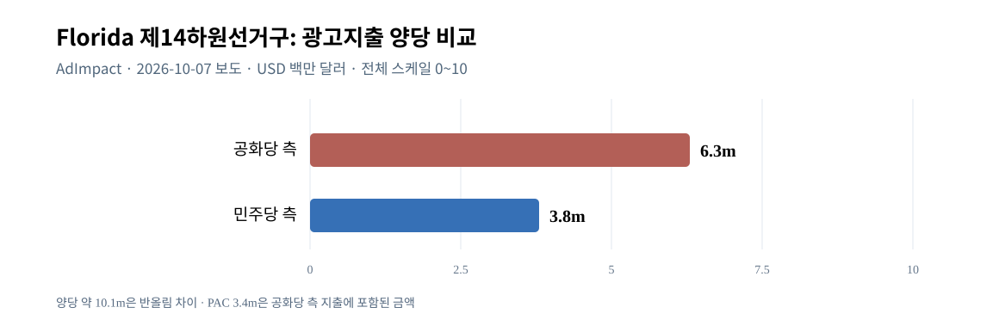

*그림 24. 보도 당시 AdImpact 추적 광고비. 후보자금·현금·승리의 인과효과와 구별. [CSV](assets/W6D-VIS-F01_fl14_ad_spend_by_side_2026.csv), [D 보완](W6_D_CANDIDATE_MONEY_INCUMBENCY_20261012.md).*

후보의 현역 여부, 지역 브랜드, 정당과 대통령의 거리, 정치 자금과 광고 집행 시점은 전국 정당선호 외의 잠재적인 경쟁 요인이다. 하지만 단순히 한쪽이 돈을 더 많이 썼다는 관측으로 그 돈이 몇 %포인트의 득표를 창출했다고 계산할 수는 없다. 실제 후보별 최신 자금·선거구 동일 시점 패널이 없으므로 현역효과의 독립 인과계수는 보류한다. [FEC 요약](https://www.fec.gov/updates/statistical-summary-of-18-month-campaign-activity-of-the-2025-2026-election-cycle/).

**소결.** 하원에서 민주당이 유리한 환경은 확인되지만 지역구 재획정·후보 개인·투표 가능성·조사오차의 결합 때문에 전국 수치를 개별 의석으로 확정 환산할 수 없다. 상원은 더 복잡하다. 주별 35개 선거의 분포, 현역과 후보, 동시 여론조사 오차 및 참여가 민주당의 순증 4석 달성 여부를 결정한다. 현재 자료는 경합의 존재를 보여주지 승패를 확정하지 않는다.

## 10. 민주당 자체의 매력과 반트럼프 동기

### 10.1 의회 후보를 고른다는 것과 정당을 좋아한다는 것의 차이

민주당의 전국 하원 선호가 44%로 공화당보다 높다는 사실만을 보면 민주당의 정책·조직 자체가 크게 인기 있어졌다고 결론 내리기 쉽다. 그러나 승인된 추가조사 E는 이 설명에 결정적인 반례를 제시한다. Pew 미국 **성인 전체**의 정당 호감 조사에서 2026년 10월 민주당은 호감 40%·비호감 58%, 공화당은 호감 37%·비호감 61%였다. 2026년 4월의 민주당 호감 39%·비호감 59%, 공화당 40%·비호감 58%와 비교해도 민주당이 폭발적인 대중적 호감 증가를 얻었다는 증거는 없다.

*그림 25. Pew 2026년 4월/10월 정당 호감·비호감, 성인 대상. 등록유권자 하원 실제 후보 선호와 모집단·문항이 다르다. [CSV](assets/W5E-VIS-F01_party_favorability_2026.csv), [원문 부록](https://www.pewresearch.org/politics/2026/10/08/midterms-2026-appendix-additional-charts/).*

Cook의 경쟁하원 지역구 LV 조사에서도 '연방의회 민주당'과 '연방의회 공화당'에 대해 양쪽 모두 호감 41%·비호감 56%라는 결과가 나왔다. 그러나 같은 지역에서 민주당 하원 후보 선호는 49%, 공화당 47%였다. **양당에 대한 부정적 평가 속에서도 후보 간 선택이 발생한다**는 점이 중요하다. 유권자는 자기가 좋아하는 당이 아니라 더 나쁘지 않다고 보는 후보, 대통령을 견제할 후보 또는 현지에서 알고 있는 후보를 선택할 수 있다.

### 10.2 반트럼프의 동원력과 민주당의 적극적 매력

Pew 등록유권자 44%가 자신의 하원 투표가 트럼프 반대의 뜻이라고 답한 것은 반대 정서가 의회선거의 중요한 동기라는 직접 근거다. 그러나 정책별로 민주당이 무엇을 제안했고 유권자가 어떤 제안을 긍정적으로 평가했는지에 대한 충분한 동일 표본 비교가 없으면, 반트럼프 동기와 적극적인 민주당 지지를 정량 분해할 수 없다. 반대로 민주당 자체 비호감이 높다는 사실이 민주당 후보에게 표를 던질 수 없다는 뜻도 아니다.

Cook의 가상 후보유형 질문에서 MAGA 공화 후보와 주류 공화 후보에 대한 반응이 달랐고, NY-21에서는 정당 장악 선호와 실제 후보 지지가 다른 방향으로 나타났다. 이 사례들은 당파적 반감뿐 아니라 **후보 유형과 정치적 대안의 신뢰도**가 실제 경합의 질을 바꿀 수 있음을 보여준다. 과거 트럼프 투표자의 공화당 하원 선택 77%와 민주당 하원 선택 5% 역시, 트럼프 반감이 즉시 상대당으로 이전되지 않는다는 다른 측면의 증거다.

따라서 이번 선거에서 민주당의 경쟁력을 해석할 때는 '(1) 정권 견제/반트럼프 동기, (2) 실제 민주당 후보·정당 선호, (3) 유권자 참여의욕, (4) 지역별 후보/선거구 효과'를 나누어야 한다. **민주당이 유리한 환경**이라는 결론은 이러한 요인들이 함께 작용할 가능성을 뜻하며, 민주당 정책에 대한 국민적 일방 전향을 뜻하지 않는다.

**소결.** 반트럼프 동기는 뚜렷하지만 양당 자체에 대한 대중적 비호감도 함께 높다. 민주당의 실제 선거 성과는 정권 비판을 지역 후보의 선택과 투표 참여로 얼마나 연결하느냐에 달려 있으며 그 전환 비율은 현재 자료로 확정할 수 없다.

## 11. AI·데이터센터·전력비: 경합지역의 새로운 경제 갈등

### 11.1 전국에서의 중요도와 지역에서의 반발은 다르다

W1~W6 초기 연구가 다룬 생활비는 인플레이션·휘발유·관세·의료를 중심으로 설명됐다. 추가조사 F는 데이터센터·AI 인프라와 가정용 전기요금이라는 **새로운 지역별 체감비용 경로**를 보완했다. 이 주제는 국가경제에 직접 영향을 줄 수 있지만 전국 선거의 중심 문제라고 확대해서는 안 된다.

Pew 2026년 10월 등록유권자 조사에서 AI가 중간선거 표를 결정하는 데 '매우 중요'하다는 응답은 전체 44%, 민주당 후보 지지층 54%, 공화당 후보 지지층 34%였다. 경제 84%보다는 낮다. 같은 조사에서 '내 주변 데이터센터 건설을 지지하는 정치인'을 부정적으로 본다는 답은 전체 61%, 민주당 후보 지지자 75%, 공화당 후보 지지자 44%였다. 이는 AI 기술 전체에 대한 반대 61%도 아니고 데이터센터 건설 전면금지 찬성 61%도 아니다. **특정 지역개발을 지지하는 정치인에 대한 평가**다.

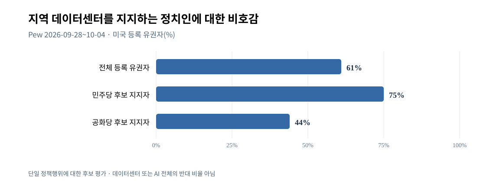

*그림 26. Pew 등록유권자의 해당 문항 비호감 응답. 세 집단은 다른 모집단이며 나머지를 모두 찬성으로 계산할 수 없다. [CSV](assets/W4F-VIS-F01_local_datacenter_politician_dislike_2026.csv), [Pew 쟁점 조사](https://www.pewresearch.org/politics/2026/10/08/economy-ranks-as-top-issue-in-midterms-for-all-voters-but-partisans-differ-over-the-importance-of-other-issues/).*

### 11.2 실제 경합지역에서의 정치적 충돌

오하이오 상원선거에서 민주당 셰러드 브라운과 공화당 존 허스티드의 경쟁에서는 데이터센터 입지, 농지, 전기요금 부담, 세제 혜택이 선거 메시지에 등장했다. 브라운 측은 전력비 부담과 기업특혜의 문제를 제기했고 허스티드 진영은 책임·정책효과에 대해 반론을 냈다. 펜실베이니아 제8하원선거구에서는 Rob Bresnahan과 Paige Cognetti의 경쟁과 지역 에너지·데이터센터 개발이 연결됐다. 미시간 및 콜로라도 일부 경쟁지역에서도 전력요금과 에너지 고용이 함께 거론됐다.

현장 보도와 후보 메시지는 **정치적 쟁점이 실제 존재함**을 뒷받침하지만, 데이터센터가 가정용 전기요금을 실제로 얼마 올렸는지에 대한 독립 전력회사 회계·시간별 인과분석을 대체하지는 않는다. 또한 데이터센터 건설에는 설비투자·일자리·지역 세수·전력계통 투자라는 편익을 주장하는 입장도 존재한다. 주민이 인근 부지개발의 비용을 우려하면서 일반적인 AI 기술의 생산성을 긍정할 수도 있다.

따라서 이 조사에서 주장할 수 있는 것은 '2026년 일부 경쟁지역에서는 기존 물가·유가 외에 **전력비·대규모 AI 인프라 개발의 비용과 편익이 후보평가의 하나의 축이 됐다**'는 제한된 결론이다. 전국의 선거 결과에서 데이터센터가 가장 큰 요인이라는 주장, 특정 후보 표 차이의 데이터센터 기여율, 전체 전력요금 상승의 확정 인과분해는 수행하지 않았다. [F 경합지역 보완 원문](W4_W6_F_DATACENTERS_ENERGY_SWINGDISTRICTS_20261012.md).

**소결.** 지역 정치에서는 기술 투자에 따른 편익과 비용이 교차하며 새로운 갈등이 생길 수 있다. 그러나 아직 이 현상을 전국에서 경제·이민·민주주의보다 우세한 단일 쟁점으로 일반화할 근거는 없다.

## 12. 경쟁가설 종합검증과 2026년 11월의 조건부 시나리오

### 12.1 강한 주장부터 무엇이 반박되는가

W7에서는 중요 주장을 단순히 지지 근거만 축적하지 않고, 시점·모집단·독립 경제실측·유권자 집단과 지역선거 반례를 대조했다.

| 경쟁 주장 | 유리한 근거 | 반례·제한 | 최종 판단 |
|---|---|---|---|
| 지지율 하락은 설문 표본의 착시일 뿐 | 기관별 측정 차이 존재 | Gallup·Pew·Ipsos의 각 기관 내 하락과 과거 Trump 투표층 승인 하락 | 단순 착시 설명은 약함 |
| 전쟁 하나로 모든 하락을 설명 | 개전 후 유가·반전 여론 | 2025년부터 개전 전 하락 | **전기간 단일 원인은 반증** |
| 경제·생활비는 주요 불만 경로 | 경제 의제84%, 경제정책 악화 평가65%, 공화층 악화35%, 유가·CPI 실측 | 고용·실질 소비의 상충 신호, 관세/전쟁 책임의 중첩 | 가장 직접적인 정합 근거, 인과 %p 보류 |
| 이민에서 공화당 우위가 완전히 소멸 | ICE 전술 반대62%, 추방 과도52% | 추방 목적 일부 지지, Cook 이민 신뢰 공화+5 | 강한 일반화 기각 |
| 외교는 중요하지 않거나 단일 실패 | 외교 판단 신뢰53→35, 우크라이나 등 우려 | 중국 호감 증가, NATO·지원 평가의 당파차·미확정 합의 | 독립 분야로 중요, 단독 인과량 없음 |
| 법원·윤리·민주주의는 주변 쟁점 | 경제가 우선 | 민주주의 매우 중요73%, 사업사익 분리 불신69 | 주변화 불가, 투표효과는 미식별 |
| CBO의 의료·재정 전망은 현재 실현 피해 | Medicaid 미래 축소 전망·KFF 의료비 신뢰 격차 | 추정시점은 2034/35, 현재 피해실측 아님 | 현재 실현 주장 기각 |
| 트럼프 대선 지지자 불만은 민주당 직접 이동 | 2024 Trump층 국정승인95→67 | 해당 집단 하원 공화77·민주5·미결정13 | 직접 전향 일괄설 기각 |
| 민주당 지지층의 높은 의욕은 실제 높은 투표율 확정 | 의욕 민주63/공화46 | 역사 2022 공화 참여 우위, 실제 2026 미발생 | 유리한 동원 신호, 실현 미확인 |
| 전국 민주+8은 하원·상원 장악 확정 | Pew 전국 RV 44/36 | Cook 37 LV 49/47, NY-21 후보효과, 주별 상원 편차 | 의석 자동 환산 불가 |
| 민주당이 유리한 까닭은 민주당 자체 인기의 폭증 | 전국 민주 후보 지지 앞섬 | 민주당 자체 비호감58%, 경합지 양당 비호감56 | 정권 견제·지역 후보 설명 병행 필요 |
| AI·데이터센터가 전국 단일 최대 쟁점 | 지역 정치인 비호감61, 일부 후보 쟁점 | AI 중요44 < 경제84, 실제 전력비·득표 효과 미측정 | 일부 지역 보완요인, 전국 단일원인 아님 |

여기서 '반증'은 관측과 논리적으로 양립하지 않는 **주장의 강한 형태**에 적용한다. 예컨대 '전쟁이 전체 하락의 원인'이라는 주장이 틀렸다는 것은 전쟁이 2026년 후반에 **추가적인 악영향을 줬을 가능성**까지 부정하는 것이 아니다. 마찬가지로 '이민 우위의 전면 붕괴'를 부정해도 ICE 집행 전술에 대한 강한 비판은 남는다.

### 12.2 국정평가에서 의석까지 이어지는 인과의 단계

첫 단계는 실제 정책·경제 환경이다. 관세, 휘발유 가격, 주거·의료비, 전쟁과 이민 단속, 정치제도에 관한 갈등이 존재한다. 두 번째 단계는 유권자가 이 가운데 무엇을 알고 누구의 책임이라고 여기는가다. Pew의 경제정책 악화 인식과 KFF의 의료비 정당 신뢰는 이 단계를 관측한다.

세 번째는 대통령 국정평가와 정당·후보에 대한 정치적 태도다. Pew 대통령 승인 30%, 정당별 호감/비호감, 2024년 트럼프 투표층 승인 67%는 이 결과를 각각 다른 방식으로 측정한다. 네 번째는 현재 지역 하원 후보 선택과 실제 11월 투표의 차이다. 전국 RV 선호·Cook 경합 LV·Siena 주별 후보 설문은 **사전 태도와 참여 가능성**을 관측할 뿐 11월 3일 투표용지의 공식 합계는 아니다.

마지막은 투표를 실제로 한 사람의 지구·주별 선택이 의석으로 변환되는 단계다. 여기는 후보 실명·현역·자금·투표율·선거구 경계·승자독식 의석 구조 등 추가 조건이 작용한다. 하나의 전국 숫자로 모든 연결을 건너뛰면 큰 오류가 발생한다.

특히 **동시에 나빠진 경제정책 평가와 대통령 승인**은 같은 정치정체성의 영향일 수도 있고, 대통령 불신이 정책평가를 악화시키는 역방향일 수도 있다. 2026년 실제 투표자 이력까지 연결한 다변량 패널·정책 노출별 신뢰성 있는 대조군이 없으므로 경제·전쟁·이민·외교 각각의 지지율 감소분을 더하거나 독자적인 정량 승리확률을 만들어서는 안 된다.

### 12.3 선거 이전에 비교할 수 있는 세 경로

**민주당에 상대적으로 유리한 경로**는 현재 전국 하원 후보 선호 우세가 실제 투표로 유지되고, 더 높은 민주당 지지층의 투표 의욕이 실제 참여까지 이어지며, 경합 지역구의 후보·선거구·투표 조직 변수가 민주당에 유리하게 작용하는 경우다. 일부 공화당 보유 주에서의 상원 경합 조사도 민주당의 기회가 있음을 보여준다. 그렇지만 특정 주나 435개 하원의 지역별 승리확률을 이 연구가 독자적으로 계산하지 않았다.

**공화당이 방어하는 경로**도 실재한다. 트럼프에 대한 평가가 약화됐어도 2024 트럼프 투표자의 77%가 현재 공화 하원 후보를 택하고, 이민 쟁점에서 공화당에 남은 상대적 신뢰, 현역·후보 개인의 지역 인지도, 정치자금과 광고지출, 선거구 재획정과 지역 구성의 차이가 작용할 수 있다. 민주당 자체의 높은 비호감은 반대통령 유권자의 동원과 민주당 정책 지지가 완전히 일치하지 않음을 보여준다.

**혼합 결과와 예상 밖의 경로**도 열려 있다. 실제 투표가 약한 민주당 지지층에 집중되지 않거나, 10월 이후 경제·외교 사건이 여론에 새 영향을 주거나, 주별 접전 조사에 체계적인 공통오차가 있으면 하원과 상원이 다른 방향으로 움직일 수 있다. 2026년 10월 Cook 등급 변경과 Siena 조사 우위는 당시의 조건부 관측일 뿐 11월 실제 개표 예고편이 아니다.

이 세 시나리오에는 **독자 계산된 발생확률이나 확정 의석수**가 없다. 비교 가능한 조건·반례를 제공하는 설명 경로이며, 실제 승부를 확정하려는 통계모형이 아니다.

## 13. 결론과 확인되지 않은 사실

장기 여론을 좌우한 변수에 대한 가장 강한 종합 관측은 두 가지다. 트럼프의 국정평가는 2025년부터 악화됐고, 2026년 경제·생활비 문제를 매우 중요하다고 보는 유권자가 많으며 경제정책을 부정적으로 평가하는 인식도 집권당 성향층까지 넓어졌다. 이란 전쟁과 이후 에너지 가격의 상승은 이를 추가적으로 자극했을 개연성이 높지만 장기 하락 전체의 출발점은 아니다.

동시에 이민 단속의 목적과 수단, 의료비와 재정법의 미래효과, 대법원의 특정 관세 권한 판결, 사적 이해관계와 민주주의 신뢰, 중국·우크라이나·NATO에 대한 평가가 서로 다른 방향과 당파별 반응을 만든다. 이를 모두 '트럼프가 인기가 없다'라는 설명 한 문장으로 줄이면 실제 왜 다른 결과가 나오는지 이해할 수 없게 된다.

선거에서 민주당에 유리한 여론·동원 신호는 실제 존재한다. 그러나 2024년 트럼프 대선 투표층 다수가 현재도 공화당 하원 후보를 선택하고 있으며, 전국 등록유권자, 선택된 37개 경합지역 투표가능유권자, 개별 지역구 후보, 서로 다른 상원 주의 조건은 일치하지 않는다. 민주당 자체에 대한 높은 비호감과 후보 개인평가, 경계가 바뀐 하원 지도, 선거자금, 지역 데이터센터 전력비 쟁점은 **불만이 실제 표와 의석으로 번역되는 과정**을 복잡하게 만든다.

따라서 2026년 10월 12일 현재의 방어 가능한 결론은 **'정권 견제와 생활비 불만이 민주당에 유리한 선거환경을 조성하지만 의회 장악은 아직 확정되지 않았다'**는 것이다. 주요 자료와 반례를 고려하면 이는 신뢰할 만한 조건부 설명이나, 실제 11월 3일 투표 결과·하원과 상원 의석·대통령 정책별 독립 지지율 기여분은 이후 자료 또는 더 강한 식별 설계가 없으면 단언할 수 없다.

다음의 불확실성은 숨기지 않는다. 조사기관별 RV/LV/성인 정의와 정치가중치의 한계, 상원 후보별 개별 질문지·표본오차 전수 확인의 미완료, 2026 현행 지도 전 지역구의 2024 대선 득표 재집계 부재, 후보의 선거 직전 현금·광고 총액의 시간차, 우크라이나·대러시아 미확정 외교조치의 실제 집행, 데이터센터의 정량 전력요금 인과효과, CBO 장기 전망과 2026 실제 시행 결과의 차이, 최종 유권자의 기권·정당전환 미관측이 그것이다. 이런 한계를 유지하는 한 현재 조사 자료는 W1~W7·승인 보완 A~F에 대해 **조건부 완료**된 연구로서 Full Report 상세형의 본문을 뒷받침한다.

## 14. 부록: 수록 그림·연구 근거·검증 조건

### 14.1 본문 그림의 보존·출처

본 보고서에는 현재 연구 브랜치의 정량·개념 SVG **26개**를 모두 관련 주장 근처에 실제 이미지로 연결했다. 이는 모든 그림이 동일한 인과적 설명력·통계적 중요도를 갖는다는 뜻이 아니다. 공통 집단 설명/정량 비교/방법론적 오류 방지에 서로 다른 역할이 있으며, 중복 정보가 확인되면 사용자 선택과 의미 보존 원칙에 따라 향후 편집에서 조정할 수 있다. 각 그림의 원시 관측값·단위·기간·표본 설명은 본문 캡션과 관련 W-ID의 CSV에 연결돼 있다. 재생성 SVG는 연구 당시의 다른 대화 UI 이미지와 픽셀 동일하다는 뜻이 아니다.

| 그림 | 주된 정보 | 연구 원문 |
|---|---|---|
| 1~5 | Gallup/Pew/Ipsos 대통령 국정승인 추세, 정책판단 신뢰, 2024 Trump 투표층 승인 | [W1](W1_SURVEY_TIMELINE.md), [W1 월별 보완](W1_2026_IPSOS_MONTHLY_RECHECK.md), [W5](W5_2024_VOTER_COALITIONS_AND_TURNOUT_20261012.md), [W3](W3_CHINA_UKRAINE_NATO_20261012.md) |
| 6~9 | BLS CPI 결측, EIA 휘발유, Pew 트럼프 경제정책 성인·공화당 평가 | [W2](W2_ECONOMIC_TIMELINE.md), [W7](W7_FULL_INTEGRATED_CAUSAL_AND_ELECTORAL_REVIEW_20261012.md) |
| 10~13 | 이란전 대응 집단별 승인, 전쟁 현저성, 국제→경제 경로 가설, NATO 지위 평가 | [W3/W7 사건 검증](W3_W7_EVENT_CAUSAL_REVIEW.md), [W7](W7_FULL_INTEGRATED_CAUSAL_AND_ELECTORAL_REVIEW_20261012.md), [W3 외교](W3_CHINA_UKRAINE_NATO_20261012.md) |
| 14~16 | 추방집행 규모, 의료비 정당 신뢰, 중간선거 주제별 중요도 | [W4](W4_IMMIGRATION_JUDICIARY_FISCAL_HEALTH_20261012.md), [W7](W7_FULL_INTEGRATED_CAUSAL_AND_ELECTORAL_REVIEW_20261012.md) |
| 17~19 | 과거 대선 투표집단의 하원 후보 선호·불만·투표 의욕 | [W5](W5_2024_VOTER_COALITIONS_AND_TURNOUT_20261012.md) |
| 20~21 | 2018/2022 중간선거 투표율의 분모가 다른 두 시계열 | [보완 C](W5_C_HISTORICAL_TURNOUT_20261012.md) |
| 22~24 | Cook 경합 하원, Siena 상원, Florida14 광고지출 | [W6](W6_HOUSE_SENATE_BATTLEGROUND_POLLS_20261012.md), [보완 D](W6_D_CANDIDATE_MONEY_INCUMBENCY_20261012.md) |
| 25~26 | 민주·공화 정당 자체 비호감, 데이터센터 지지 정치인 비호감 | [보완 E](W5_W6_E_PARTY_APPEAL_VS_ANTI_TRUMP_20261012.md), [보완 F](W4_W6_F_DATACENTERS_ENERGY_SWINGDISTRICTS_20261012.md) |

새 재획정 지도는 2026 현행 경계의 GIS와 과거 경계 매칭을 전수 재집계하지 않았기 때문에 임의로 만들지 않았다. 자료의 부재를 근거가 있는 숫자처럼 시각화하지 않으려는 의도적인 선택이다. 추가조사 B의 정치가중치 효과도 일률적인 2026 예측보정 그래프를 만들지 않고 방법론 설명으로 반영했다.

### 14.2 원자료·조사기관 접근 경로

아래는 본문에서 반복 인용한 공개 1차/준1차 자료의 중심 경로다. 세부 후보·지역 기사·논문·개별 질문지는 연결된 W-ID 문서에 실제 출처와 함께 보존된다.

- [Gallup/Pew/Ipsos 시계열과 대통령 정책 신뢰](W1_SURVEY_TIMELINE.md); [Pew 2026-10 트럼프 국정승인](https://www.pewresearch.org/politics/2026/10/08/trumps-approval-rating-drops-as-fewer-americans-are-confident-in-his-handling-of-the-economy-other-issues/)
- [BLS CPI](https://www.bls.gov/news.release/cpi.t05.htm) · [EIA 미국 전국 휘발유](https://www.eia.gov/dnav/pet/hist/LeafHandler.ashx?f=W&n=PET&s=EMM_EPMR_PTE_NUS_DPG) · [W2 경제복원](W2_ECONOMIC_TIMELINE.md)
- [Pew 2026-10 체감 경제·경제정책 평가](https://www.pewresearch.org/politics/2026/10/08/cost-concerns-dominate-as-publics-economic-ratings-turn-more-negative/) · [W7 통합평가](W7_FULL_INTEGRATED_CAUSAL_AND_ELECTORAL_REVIEW_20261012.md)
- [Pew 이란 전쟁 여론](https://www.pewresearch.org/short-reads/2026/10/08/iran-conflict-remains-deeply-unpopular-as-many-americans-expect-it-to-go-on-for-months/) · [W3 외교](W3_CHINA_UKRAINE_NATO_20261012.md)
- [Pew 전체 중간선거 투표연합](https://www.pewresearch.org/politics/2026/10/08/with-americans-in-a-sour-mood-democratic-voters-are-more-engaged-in-midterms/) · [Pew 인구집단별](https://www.pewresearch.org/politics/2026/10/08/midterm-vote-preferences-by-race-and-ethnicity-age-and-other-demographics/) · [방법론](https://www.pewresearch.org/politics/2026/10/08/midterms-2026-methodology/)
- [Pew 정치가중치 연구](https://www.pewresearch.org/methods/2026/09/16/weighting-polls-on-party-affiliation-and-past-vote/) · [보완 B](W6_B_POLL_ERROR_AND_METHOD_20261012.md)
- [인구조사국 제120대 하원 지구](https://www.census.gov/programs-surveys/decennial-census/about/rdo/congressional-districts.html) · [보완 A](W6_A_REDISTRICTING_STRUCTURE_20261012.md)
- [Census 중간선거 투표율](https://www.census.gov/newsroom/press-releases/2024/congressional-election-voting-report.html) · [Pew 2022 참여구성](https://www.pewresearch.org/politics/2023/07/12/republican-gains-in-2022-midterms-driven-mostly-by-turnout-advantage/) · [보완 C](W5_C_HISTORICAL_TURNOUT_20261012.md)
- [FEC 의회선거 자금 보고](https://www.fec.gov/updates/statistical-summary-of-18-month-campaign-activity-of-the-2025-2026-election-cycle/) · [보완 D](W6_D_CANDIDATE_MONEY_INCUMBENCY_20261012.md)
- [Pew 정당 호감 부록](https://www.pewresearch.org/politics/2026/10/08/midterms-2026-appendix-additional-charts/) · [보완 E](W5_W6_E_PARTY_APPEAL_VS_ANTI_TRUMP_20261012.md)
- [Pew 선거 의제·AI·데이터센터](https://www.pewresearch.org/politics/2026/10/08/economy-ranks-as-top-issue-in-midterms-for-all-voters-but-partisans-differ-over-the-importance-of-other-issues/) · [보완 F](W4_W6_F_DATACENTERS_ENERGY_SWINGDISTRICTS_20261012.md)
- [Cook 경쟁 하원 연구](https://www.cookpolitical.com/survey-research/2026-battleground-district-project) · [Cook 10월 판세평가](https://www.cookpolitical.com/analysis/house/house-overview/eighteen-more-house-race-ratings-move-democrats-favor) · [Siena 상원 5개 주](https://sri.siena.edu/2026/10/03/nytimes-siena-poll-of-likely-voters-senate-races/) · [W6 지역구·상원](W6_HOUSE_SENATE_BATTLEGROUND_POLLS_20261012.md)
- [CBO 재정 전망](https://www.cbo.gov/publication/62105) · [KFF 의료비 선거 여론](https://www.kff.org/public-opinion/kff-health-tracking-poll-health-care-issues-in-the-lead-up-to-the-2026-midterm-election/) · [W4 상세](W4_IMMIGRATION_JUDICIARY_FISCAL_HEALTH_20261012.md)

### 14.3 향후 재검증이 필요한 조건과 원고의 사용 한계

이 보고서를 2026년 10월 12일보다 뒤 시점의 선거 여론을 나타내는 문서로 쓰려면 새 자료와 판본을 다시 확인해야 한다. 이후의 개표·투표참여·선거구 판결·상원 후보 변경·통계 개정이 발생할 수 있다. 그때는 영향을 받은 W-ID와 관련 본문을 국소 갱신해야 하며, 기존 조사값을 새 결과인 것처럼 쓰면 안 된다.

현재 원고는 장기 여론·정책과 정치행동의 **조건부 설명**을 제공한다. **실제 선거결과 보고서, 실험적 인과추정 논문, 독자적 선거승률 모형이 아니다.** 이 세 가지를 원한다면 해당 요구에 맞는 추가 자료·방법과 별도의 검증이 필요하다.

**W8 원고 상태:** 사용자 승인 A안과 '마무리까지' 요청에 따라 작성·검수·연구 브랜치 보존을 완료한 한국어 Full Report(Expanded) 정본. W1~W7 및 사용자 승인 A~F의 중요한 고유 사실·반례·측정 조건을 본문에 반영했다. 선거 전 관측 및 미확인 인과효과의 조건부 결론, 원문·이미지 렌더의 검증 한계는 유지한다. PDF 생성이나 외부 게시를 허가받은 것은 아니다.
