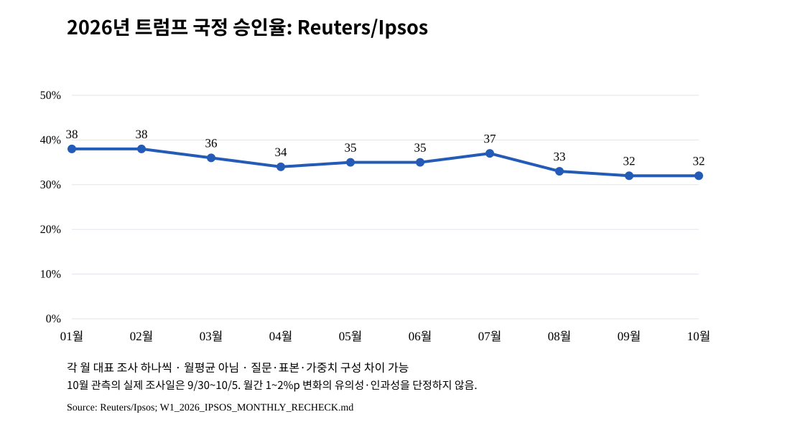

# W1 3차 정밀 보완 — Reuters/Ipsos 2026년 1~10월 월별 대표 조사
연구 기준: 2026-10-11 KST | 범위: 미국 성인 전체 국정 수행 승인, Reuters/Ipsos (Ipsos KnowledgePanel 확률표본). 전수 연속모니터나 통계적 월평균 아님. 기존 `W1_SURVEY_TIMELINE.md` 원본 유지.
## 대표 관측(각 월 정확한 조사 시기 명시)
| 월 | 필드일 | 승인 % | 표본·출처 | 상태/중요 주의 |
|---|---|---:|---|---|
| 2026-01 | Jan 23–25 | 38 | n=1,139 미국 성인, Reuters/Ipsos | 공식 Reuters 보도; 초기 월 예외적으로 Jan4–5 42%, Jan12–13 41%도 있어 한 달 평균 38 아님 |
| 2026-02 | Feb 13–16 | 38 | Ipsos core political | UCSB/APP 역사 레지스트리 및 Ipsos 2월 승인 추적 페이지 |
| 2026-03 | Mar 20–23 | 36 | n=1,272 KnowledgePanel; Ipsos | +/-2.8%p overall MOE; 같은 달 앞선 조사 승인 38–40% 범위 언급 |
| 2026-04 | Apr 24–27 | 34 | n=1,269 KnowledgePanel; Ipsos | 승인 성인 34%; 같은 조사 등록유권자 37%와 구별 |
| 2026-05 | May 15–18 | 35 | n=1,271 성인; Reuters/Ipsos | 공식 35%; 조사문항 및 모집단 다름 주의 |
| 2026-06 | Jun 3–8 | 35 | n=4,531 성인 대규모 조사; Ipsos | 후속 Jun12–15 성인 약36% 별도 조사 존재; 대형조사와 core 혼재 |
| 2026-07 | Jul 24–26 | 37 | Reuters/Ipsos n≈1,246 미국 성인 | 공식 Ipsos July tracker 필드 기간 + Silver Bulletin 2026-07-30 원자료 아카이브 수치 대조. topline 직접 검독 미완 |
| 2026-08 | Aug 21–24 | 33 | Reuters/Ipsos Core KnowledgePanel; Ipsos | 같은 달 Aug 3 종료 대형조사(7/29–8/3) 승인35%, Aug14–17 core33%, Aug21–24 33%; '8월 평균' 아님 |
| 2026-09 | Sep 17–20 | 32 | n=1,277 KnowledgePanel; Ipsos | ±2.8%p 전체 표본, 하위집단 오차 더 큼 |
| 2026-10 | Sep 30–Oct 5 | 32 | n=4,506 KnowledgePanel; Ipsos | 10월 발표·종료, 필드 시작 9월 30일; 등록유권자 별도값 구별 |

## 추적 가능한 출처(중요값별)
- [UCSB American Presidency Project 트럼프 2기 조사 원장](https://www.presidency.ucsb.edu/statistics/data/donald-j-trump-2nd-term-public-approval), 기관별 혼합 집계가 아니라 개별 행 사용.
- [Ipsos Jan 2026 tracker](https://www.ipsos.com/en-us/president-trump-approval-rating-january-2026) 및 [Reuters 1/26 이민·전체 승인 보도](https://www.reuters.com/world/us/trumps-immigration-approval-drops-record-low-reutersipsos-poll-finds-2026-01-26/).
- [Ipsos Feb 2026 tracker](https://www.ipsos.com/en-us/president-trump-approval-rating-february-2026).
- [Ipsos Mar20–23 공식 발표](https://www.ipsos.com/en-us/economy-and-foreign-conflicts-now-publics-top-two-issue-concerns).
- [Ipsos Apr24–27 공식 발표](https://www.ipsos.com/en-us/americans-increasingly-feel-economy-wrong-track).
- [Ipsos May tracker](https://www.ipsos.com/en-us/president-trump-approval-rating-may-2026) 및 [Reuters May19 보도](https://www.reuters.com/).
- [Ipsos Jun3–8 공식 발표](https://www.ipsos.com/en-us/reutersipsos-june-2026-poll).
- [Ipsos Jul tracker](https://www.ipsos.com/en-us/president-trump-approval-rating-july-2026) 및 [Silver Bulletin 2026-07-30 snapshot](https://archive.li/2026.07.31-071606/https%3A/www.natesilver.net/p/trump-approval-ratings-nate-silver-bulletin).
- [Ipsos Aug21–24 이란/국정 조사](https://www.ipsos.com/en-us/americans-continue-expect-extended-us-military-involvement-iran) 및 [Ipsos Aug3 종료 대형조사](https://www.ipsos.com/en-us/reutersipsos-august-2026-poll).
- [Ipsos Sep17–20 발표](https://www.ipsos.com/en-us/republicans-rating-trump-cost-living-declines).
- [Ipsos Sep30–Oct5 발표](https://www.ipsos.com/en-us/reutersipsos-october-survey) 및 [Reuters Oct5 승인32% 보도](https://www.reuters.com/world/us/trump-approval-record-low-hispanic-voters-sour-on-republicans-reutersipsos-poll-2026-10-05/).
- 2026 월별 중 1월은 **복수 시점** 42/41/38; 8월은 35/33/33. 단일시점 선택에 따른 인위적 월간 '급락'을 피해야 함.

## 감사 판정
- 확인: 2026-01~10 매월 Reuters/Ipsos 조사 시점 대표관측 발견. 1월 38%와 10월 32% 차이는 6%포인트; 7월 반등, 8~10월 하락/정체.
- 불확실: 각 행의 **동일한 질문 문구·표본 추출·가중치 공식의 완전 동일성**은 모든 PDF topline을 독립 전수 검사하지 않았으므로 미확정. Core 정치조사와 이슈별 대형조사는 n~1.1–4.5k, 설계·가중치 NPORS 2025/26 갱신과 질문 순서가 달라질 수 있음.
- 개별 월 1~2%포인트 움직임은 ±약 3%p 표본오차와 설문설계 차이 때문에 추세 변화로 단정 불가. 1월 38% vs 10월32%도 개별 표본오차·설계효과를 고려한 통계적 검정 없이 확정 인과나 계단식 변화로 표현 금지.
- 월별 지지율 수치와 여론 이슈 중요도·중간선거 의향은 다른 종속변수. 향후 Ipsos PDF 원질문/방법 전체를 검독하고 월별 통합 시계열 보정 가능.

## W1-VIS-F03 (연구 중간 보고서 실제 그래프의 재생성 명세)
- 대상: Reuters/Ipsos 2026-01~10 미국 성인 국정 승인율. 값(조사 월별 대표 관측): 38, 38, 36, 34, 35, 35, 37, 33, 32, 32%. 정확한 각 조사 시작/종료일·모집단·이견은 위 표에 기록. **월평균 아님**; 동일 달 다중 조사(1월 42·41·38, 8월 35·33·33) 고려. 2026-10 포인트는 실제 필드 Sep30–Oct5.
- X=조사 월 10개 범주(실제 필드 간 간격 및 시작 날짜 불균등), Y=0~50%, 단위=%, 한 개 선/원점 표시, 도표 원자료=위 표 W1 3차 대표 10행. 앞선 중간 채팅 그래프의 10개 수치를 위 표와 10/10 수치 대조. 실제 채팅 UI 차트 픽셀/툴팁 원형은 미수집 UNKNOWN. 각달 1~2%p 변화는 표본오차·질문 순서/가중치·core/large 표본 구성 차이로 유의성을 단정하지 않음.
- 2026-07 대표 37% 및 약 n=1,246 성인은 Reuters 보도(https://www.reuters.com/world/us/just-one-three-americans-back-iran-war-most-unsure-trumps-goals-reutersipsos-2026-07-27/)와 제3자 원자료 표(https://archive.li/2026.07.31-071606/https%3A/www.natesilver.net/p/trump-approval-ratings-nate-silver-bulletin)에서 독립 확인; 정밀 topline PDF 전체 문항/가중치 감사 전까지 방법 동일성 CONDITIONAL.

### W1-VIS-F03 실제 시각자료 보존 (2026-10-11)

- [SVG 그래프](assets/W1-VIS-F03_reuters_ipsos_approval_2026.svg) · [CSV 원데이터](assets/W1-VIS-F03_reuters_ipsos_approval_2026.csv). 각 월의 필드 날짜·표본·조사설계 제한은 위 본문에 보존되어 있다.
- 2026년 10월 표본은 9/30~10/5 조사. **월간 평균이 아닌 대표 관측치이며, 각 조사 방법이 완전히 동일하다고 검증되지 않았다.**
- 그림 원본: 검증된 W1 수치로 재생성한 SVG. 과거 ChatGPT UI의 실제 픽셀·툴팁과 동일 여부는 UNKNOWN.
- 최종보고서: W1 중요 시각자료 편입 후보. 최종 본문 수록 위치는 사용자 편집 선택 후 확정.
