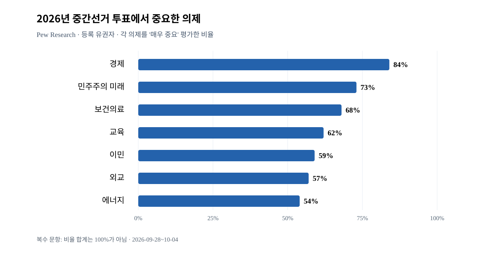
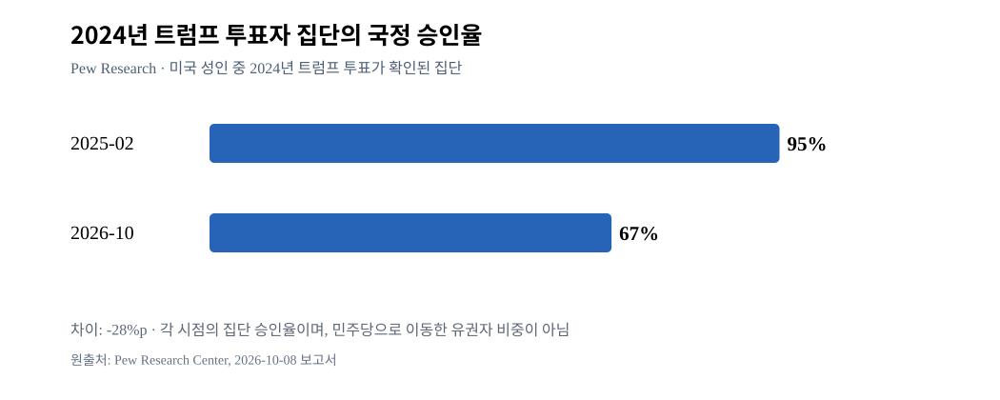

# W1_W3_INITIAL_EVIDENCE — 2026-10-11 최초 근거 묶음
상태: **1차 부분 조사**, 검증된 숫자와 해석의 분리. 최종 종합판정 아님.

## E1: 트럼프 국정 지지율의 동일 기관 추세 (W1)
- Pew Research Center 2026-10-08 보고서, 미 성인 5,062명, 필드 2026-09-28~10-04: 국정 승인 30%, 반대 68%; 2026-07 34%, 2026-04 34%, 2026-01 37%, 2025-09 40%, 2025-02 47%. 조사기관과 문항이 일치하는 시계열이며 각 표본은 동일한 개인 패널 추적과 혼동 금지.
- Pew 원문: https://www.pewresearch.org/politics/2026/10/08/trumps-approval-rating-drops-as-fewer-americans-are-confident-in-his-handling-of-the-economy-other-issues/
- Pew 2026-10-08 개요: https://www.pewresearch.org/politics/2026/10/08/with-americans-in-a-sour-mood-democratic-voters-are-more-engaged-in-midterms/
- Gallup 2025-01-21~27 47% 승인, 2025-07 37%, 2025-10 41%, 2025-11/12 36%. **Gallup 2025 수치와 Pew 2026 수치를 1개 연속 기관 추세로 연결하지 않음**. https://news.gallup.com/poll/203198/presidential-approval-ratings-donald-trump.aspx
- Reuters/Ipsos 2026-09-30~10-05 성인 4,506명 KnowledgePanel 표본: 국정 승인 32% (Reuters 보도). 연구기관 원문은 조사 설계/시점 확인. 본문 요약 수치가 없으면 개별 질문지를 별도 조회해야 함. https://www.ipsos.com/en-us/reutersipsos-october-survey ; https://www.reuters.com/world/us/trump-approval-record-low-hispanic-voters-sour-on-republicans-reutersipsos-poll-2026-10-05/
**잠정 해석**: 하락은 한 조사에만 보이는 이탈이 아니나, 규모·시점을 혼합기관 평균으로 정량 확정하기 전에 기관·문항별 자료가 더 필요하다.

## E2: 2024 투표층과 2026 의회 투표 선호 (W5/W6)
- Pew 2024 트럼프 투표자 검증 집단: 2025-02 승인 95% → 2026-10 승인 67% (-28%p); 2026-10 반대 31%; 2026-07 승인 75%.
- 하위그룹: **2024 트럼프에게 투표했던** 히스패닉 중 현재 승인 57%, 백인 69%, 당시 19~34세에 해당하는 트럼프 투표층 현재 승인 49%. *전체 히스패닉 지지율이나 실제 민주당 투표전환율이 아님*. 히스패닉 하위표본 특히 2025-02는 효과표본 95, MOE ±10.1%p. 출처: Pew 상기 E1 원문.
- Pew 2026-09-28~10-04 **등록 유권자** 3,917명, 하원 투표 선호 민주 44%·공화 36%·기타 5%·모름 15%. 지역별 실제 후보명을 보여준 응답 문항(일부 주 예외)이므로 단순 무기명 generic ballot과 정확히 동일하지 않음.
- 같은 Pew 조사 전체 히스패닉 등록 유권자의 하원 후보 민주 51%, 공화 24%, 기타 7%, 모름 18%. 2024 트럼프에 투표한 히스패닉의 현 국정승인 57%와 모집단과 질문이 완전히 다름. https://www.pewresearch.org/politics/2026/10/08/midterm-vote-preferences-by-race-and-ethnicity-age-and-other-demographics/
- Pew 등록 유권자 중 투표를 '트럼프에 반대'로 생각 44%·'트럼프 지지' 19%·영향 없다 36%. 따라서 44%는 민주당 직접 득표율이 아님.
- Pew 등록유권자 중 경제를 의회선거 매우 중요한 의제로 지목 84%; 민주 후보 지지자 88%, 공화 후보 지지자 82%. 출처 E1 개요.
- Reuters/Ipsos 2026-09-30~10-05 **등록 유권자** 대상 하원 선호 민주 44%, 공화 37%; Pew 44/36과 숫자가 비슷하지만 다른 조사임. Reuters 보도 링크 E1.
- Pew 등록 유권자에서 투표 의욕에 의한 표본 차이가 크며 투표의향/참여와 실제 투표율은 같지 않음.
**잠정 해석**: 2024년 트럼프 투표층 내 국정 불만 증가와 의회선거 여론 지표가 공존. '원래 트럼프 투표자 28%p가 민주당으로 이탈'이라는 추론은 자료로 성립하지 않음.

## E3: 경제—실물 데이터와 체감 평가 분리 (W2)
- BLS **2026년 9월 고용보고서**(10월 2일 발표): 비농업 취업자수 +29,000명, 실업률 4.2%. https://www.bls.gov/news.release/empsit.htm
- BLS **2026년 8월 CPI**(9월 11일 발표): 전년 동월 대비 종합 CPI +3.4%, 전월 대비 계절조정 +0.4%, 휘발유 가격지수 +3.9%(월간); 주거비 지수 월간 +0.3%. https://www.bls.gov/news.release/cpi.htm
- '낮은 해고/실업과 약한 신규채용' 두 특성 공존. 2026-10-08 초기 실업급여 청구 197,000건 보도(노동부 원문 교차검증 후 확정). https://www.reuters.com/business/us-weekly-jobless-claims-fall-layoffs-remain-low-2026-10-08/
- 실제 경제 수치를 대통령 책임이나 특정 전쟁의 인과효과로 단정하지 않음. 데이터 발표 후 수정·새 CPI 발표 여부 추적.

## E4: 외교/무역과 생활비에 관한 **인지된** 연결 (W3)
- Chicago Council 2026 연례 조사 필드 **2026-07-10~21**, 보고서 2026-10-01: 가장 중요한 투표 의제로 이란 전쟁 2%, 전쟁이 생활비에 악영향이라는 평가 86%, 관세가 생활비에 악영향이라는 평가 81%; 관세가 미국 경제에 악영향 71%. 이 수치는 유권자 인식, 실측 경제적 인과량 아님. 관세의 생활비 악영향을 공화당 지지층 62%도 인정하지만 공화당 지지층 64%는 일자리에는 긍정적이라 평가: 상반된 정책 효과 인식 공존.
  https://globalaffairs.org/research/public-opinion-survey/americans-foreign-policy-and-2026-midterms
- Pew 2026-09-28~10-04 미 성인 조사: 이란 군사행동 처리 승인 33%, 불승인 65%. 2026년 3월 동일 질문 승인 37% → 10월 33%; 공화·공화성향 69% →63%, 민주·민주성향 9%→9%. '전쟁 지지 감소'와 '전체 국정 승인 감소' 사이 인과 경로는 아직 미식별.
  https://www.pewresearch.org/short-reads/2026/10/08/iran-conflict-remains-deeply-unpopular-as-many-americans-expect-it-to-go-on-for-months/
**잠정 해석**: 외교 이슈를 직접 최우선 투표 의제로 꼽지 않는 응답자도 전쟁·관세의 물가 영향을 인식함. 그러나 질문 방식, 전쟁 전 경제 상황, 응답자의 정당 성향 등 경쟁 설명 확인 필요.

## E5: 반론·한계·다음 검증 (W7)
1. '전쟁이 트럼프 인기 하락의 전부'는 불성립: Pew 추세는 2025년부터 이미 하락, 2026 3월 전쟁 이후 개별 항목 승인 둔화는 추가 요인일 수 있어도 원인 추정 미완성.
2. 2025 Gallup 47% vs 2026 Pew 30%를 같은 기관에서 17%p 추세라 쓰면 오류: Pew 자체 초기 47%와 2026 30% 연결해야 함.
3. 경제 전쟁 연계 응답(86%)과 실제 경제 인과 증명은 다름.
4. 2024 투표 집단 국정승인율 67%, 전체 히스패닉 국정승인 24%(Reuters 보도), 히스패닉 하원 민주 후보 선호 51%(Pew)는 모두 **모집단/질문 차이**로 별개.
5. 전국 등록 유권자 의회 후보 선호는 선거구 구조·투표율·후보별 상황 없이 의석 분배/승패로 환산할 수 없음.
6. 2026-10-11 이후 사건이나 아직 발생하지 않은 선거 결과는 근거에서 제외.

## 남은 조사
- W1 기관별 전기간 정밀 복원, 시계열 오차·조사기간 일치.
- W2 EIA 주별 평균 유가, 인플레이션 및 실질임금, 소득·주택비, 관세의 정부/학계 추정.
- W3 전쟁 사건 상세 연표, 중국·우크라이나·동맹 각 공식 사건 및 반례.
- W4 이민/사법/복지 등 정책별 지지, W5 집단 표본, W6 경합주.
- W7 사건연표와 여론 변곡점에 대한 다원적 경쟁설명 평가.

## 현재 권장 다음 과정
W1 시계열 + W2 공식 경제지표의 비교 가능성부터 완성하면서 E4 경제적 전이 인식과 물리적 지표를 대조한 후, W3 전쟁/관세 직접 인과 분석을 진전시킨다. 사용자 첫 조사 결과 검토 관문에서 경로 선택 예정.

## E6: 쟁점별 신뢰도·국내정치·경제 이슈 우선순위 (W4/W6 예비)
- Pew 2026-09-28~10-04 미국 성인: 트럼프가 '경제에 관해 좋은 결정을 할 것으로 자신 있음' 35%; 2024-11 59%, 2025-04 45%, 2026-04 42%. 이는 **현재 경제상황에 대한 지지율과는 별개의 질문**. 동일 설문 2026-10 외교적 결정 신뢰 35%(2024-11 53%), 이민 결정을 신뢰 41%(2024-11 53%).
  https://www.pewresearch.org/politics/2026/10/08/trumps-approval-rating-drops-as-fewer-americans-are-confident-in-his-handling-of-the-economy-other-issues/
- Pew 2026-09-28~10-04 **등록 유권자** 중요 이슈(각각 '매우 중요' 비율): 경제 84%, 민주주의의 미래 73%, 보건의료 68%, 교육 62%, 이민 59%, 외교 57%, 에너지 54%, 강력범죄 52%. **한 가지 최우선 이슈만 고르게 한 질문이 아님**. 공화 후보 지지자: 경제 82%, 이민 72%, 민주주의 69%; 민주 후보 지지자: 경제 88%, 민주주의 85%, 의료 82%, 이민 53%. 위 E4 Chicago Council의 '최우선 단일 이슈' (이란 전쟁 2%)와 질문/시점/모집단 다름.
  https://www.pewresearch.org/politics/2026/10/08/economy-ranks-as-top-issue-in-midterms-for-all-voters-but-partisans-differ-over-the-importance-of-other-issues/
- Pew 2026-10 등록 유권자 중 하원 선호가 민주 44%·공화 36%였지만 **극도로 투표동기가 높다**고 답한 집단에선 민주 59%·공화 35%. 의욕 집단은 확정 실제 투표자 아님. Pew 자료에서 일부 선거구 실제 후보명을 제시하였으므로 단순 generic ballot 보다는 구체적 문항이 다름.
  https://www.pewresearch.org/politics/2026/10/08/midterm-vote-preferences-by-race-and-ethnicity-age-and-other-demographics/
- **반례**: 낮은 실업률, 낮은 신규 실업급여 신청은 노동시장의 단순 붕괴 서술에 맞지 않음. 반면 신규 채용 둔화는 별도로 존재; 체감 경제를 명목 물가상승률 한 숫자로 설명해선 안 됨. 2026-09 취업 증가 29k vs 2026-08 CPI 전년 대비 3.4%, 서로 다른 달.
- **연구 설계 주의**: 대통령 국정승인, '좋은 결정을 할 신뢰', 선거쟁점의 '매우 중요', 특정 의회후보 선호는 각각 다른 종속변수다. E6를 E1과 단일 척도로 합치지 않는다.

## 초기 채팅 보고서 핵심 시각자료의 정보 보존 (2026-10-11 최신 main 추가감사)
- 그림 ID E2-F01: **2024년 트럼프 투표 확인 집단**의 국정 승인율 2025-02 95%, 2026-10 67%. 두 카드의 서로 다른 조사시점·같은 분류의 과거 투표 집단 승인율이며 직접 투표 전환율/개인의 인과 변화가 아님. 자료 Pew 위 E2. 한편 Pew 전체 미국 성인 국정승인은 47→30으로 모집단이 다르므로 동일 표본 서술 금지. 원래 UI 카드 픽셀/레이아웃 복원성 UNKNOWN.
- 그림 ID E6-F01: **미국 등록 유권자**가 2026-09-28~10-04 각 문제를 중간선거 투표에서 '매우 중요'하다고 답한 비율: 경제 84, 민주주의의 미래 73, 보건의료 68, 교육 62, 이민 59, 외교 57, 에너지 54 (%). 가로형 막대, x=의제, y=0~100%, 각 문항 독립 응답(합계 100%가 아님). 원자료 링크: https://www.pewresearch.org/politics/2026/10/08/economy-ranks-as-top-issue-in-midterms-for-all-voters-but-partisans-differ-over-the-importance-of-other-issues/ ; 위 E6 본문 수치와 7/7 대조. Chicago Council의 '한 가지 가장 중요한 투표 문제' 2%와 **질문 및 모집단·조사시점 혼합 금지**. 원본 ChatGPT 그래프 이미지/툴팁은 보존되지 않음(UNKNOWN).
- 초기 보고서의 Reuters/Ipsos 32%, Pew 30% 대형 숫자 카드도 서로 다른 조사기관·날짜를 유지해야 함. 등록 유권자 하원 선호(Reuters/Ipsos 민주44/공화37, Pew 민주44/공화36)는 국정 승인과 별도의 문항. 표/카드로 변환 시 '등록 유권자'와 '미국 성인'을 명시한다.

## [현행 2026-10-12] 초기 여론·선거 의제 그림 실물 보존
- **E6-VIS-F01**: Pew 2026-09-28~10-04 미국 **등록 유권자**의 중간선거 투표 의제별 '매우 중요' 응답: 경제84·민주주의 미래73·의료68·교육62·이민59·외교57·에너지54%. **원자료 중 선택한 7개 의제**로 전체 의제 목록이나 전체 순위가 아님. 한 가지 최우선 문제를 고르는 질문이 아니며 비율 총합은 100%가 아님. 이전 채팅 그래프 일곱 항목과 7/7 대응.

[SVG](assets/E6-VIS-F01_midterm_issue_importance_2026.svg) · [CSV](assets/E6-VIS-F01_midterm_issue_importance_2026.csv). 원출처: https://www.pewresearch.org/politics/2026/10/08/economy-ranks-as-top-issue-in-midterms-for-all-voters-but-partisans-differ-over-the-importance-of-other-issues/
- **E2-VIS-F01**: Pew의 **2024년 트럼프 투표 검증 집단** 국정 승인율 2025-02 95%·2026-10 67%. 과거 투표자를 기준으로 한 두 조사 시점의 집단 승인율이지 그 집단의 민주당 투표전환율 또는 개인의 인과 변화량이 아님.

[SVG](assets/E2-VIS-F01_trump_2024_voters_approval.svg) · [CSV](assets/E2-VIS-F01_trump_2024_voters_approval.csv). 원출처: https://www.pewresearch.org/politics/2026/10/08/trumps-approval-rating-drops-as-fewer-americans-are-confident-in-his-handling-of-the-economy-other-issues/
- 실제 그래프는 연구의 확인된 데이터를 사용한 **별도 재생성본**으로 과거 채팅 UI 픽셀·도구팁을 복제한 것이 아님. 본문 다른 모집단(전체 미국 성인, 등록유권자, 과거 트럼프 투표층) 혼합 금지.
