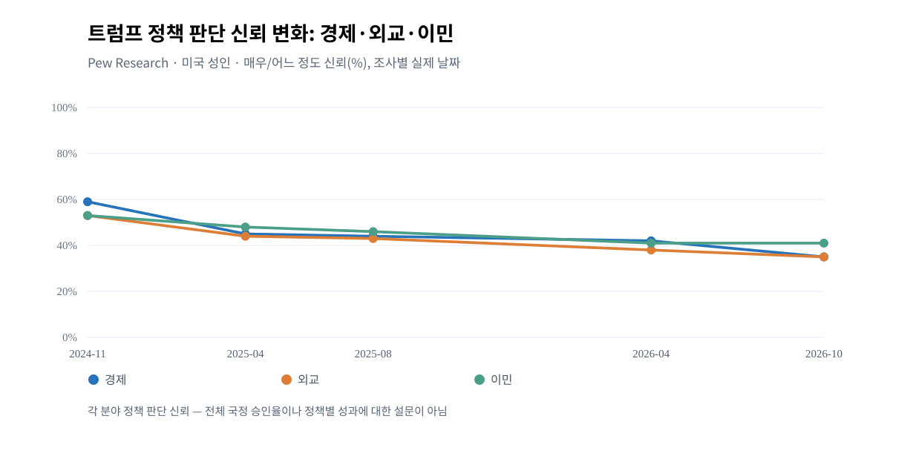
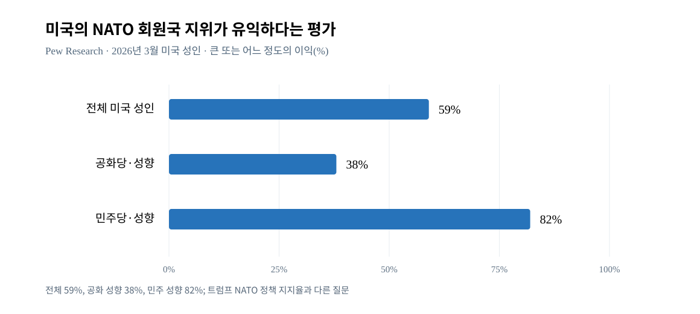

# W3 — 중국·우크라이나·NATO·동맹 및 트럼프 외교평가: 4차 심층조사
기준일 2026-10-12 KST. 상태 **부분완료(4차)**. 본조사 근거 확장; 최종 종합판정 아님.

## W3-01 정책 사건 연표와 정책 원문
| 날짜 | 실제 사건 | 1차 근거 | 확인/주의 |
|---|---|---|---|
| 2025-04-02 | EO 14257 상호관세 발표 | https://www.whitehouse.gov/presidential-actions/2025/04/regulating-imports-with-a-reciprocal-tariff-to-rectify-trade-practices-that-contribute-to-large-and-persistent-annual-united-states-goods-trade-deficits/ | 관세의 최초 발표와 각월 실제 세율 다름 |
| 2025-05-12 | 미중 제네바 공동성명: 추가 상호관세의 24%p 90일 유예, 10%p 유지, 새 보복 일부 철회 | https://www.whitehouse.gov/articles/2025/05/joint-statement-on-u-s-china-economic-and-trade-meeting-in-geneva/ | 기존 Section 301/232 등 **다른 관세까지 폐지했다는 뜻 아님** |
| 2025-06-25 | NATO 헤이그 선언: 2035년까지 GDP 5%(핵심국방 최소3.5%+광의안보 최대1.5%), 집단방위 제5조·우크라이나 지원 재확인 | https://www.nato.int/en/about-us/official-texts-and-resources/official-texts/2025/06/25/the-hague-summit-declaration?selectedLocale=en | NATO 회원국들의 **목표 약속**, 현재 달성 실적 아님. 미국 행정부 공적 주장의 일부를 독립 NATO 원문으로 검증 |
| 2025-08-11 | 미중 스톡홀름 공동성명: 제네바의 24%p 유예 90일 연장 | https://www.whitehouse.gov/briefings-statements/2025/08/joint-statement-on-u-s-china-economic-and-trade-meeting-in-stockholm/ | 일시적 합의 vs 항구적 화해 구별 |
| 2025-03-11 | 미·우크라이나 제다 공동성명: 정보 공유·안보지원 재개, 우크라이나의 조건부 30일 휴전 제안 수용 | https://www.reuters.com/world/text-us-ukraine-statement-paving-way-resumption-aid-intelligence-sharing-2025-03-11/ | **러시아까지 실제 휴전에 동의했다는 뜻 아님** |
| 2026-02-20 | 미 연방대법원 Learning Resources v Trump: IEEPA 관세 부과 권한 부정 | https://www.supremecourt.gov/opinions/25pdf/24-1287_new_3135.pdf | 모든 관세의 일괄 무효화 아님 |
| 2026-05-14~17 | 트럼프-시진핑 회담 뒤 백악관이 발표한 전략적 안정·무역 협의 합의 | https://www.whitehouse.gov/fact-sheets/2026/05/fact-sheet-president-donald-j-trump-secures-historic-deals-with-china-delivering-for-american-workers-farmers-and-industry/ | 백악관 성과 홍보 자료. 실제 효익과 중국측 이행에 대한 독립 교차 검증 필요 |
| 2026-10-07 | 대만 측 대미관계 견고 평가; 미국의 대만 군사판매 보류 보도 | https://www.reuters.com/world/china/taiwans-us-envoy-says-ties-robust-after-trump-xi-summit-2026-10-07/ | 대만 발언과 관측, 실제 판매·보류 현황 추후 추가 확인 |
| 2026-10-11 | 트럼프 러시아산 경유 거래·에너지 휴전 주장; 미 초당파 의원 반발과 우크라이나 측 합의내용 확인 대기 | https://www.reuters.com/business/energy/prominent-republican-senator-says-trumps-russian-diesel-deal-may-be-illegal-2026-10-11/ ; https://www.reuters.com/world/europe/ukraine-awaits-details-ceasefire-proposals-us-russia-maintains-attacks-zelenskiy-2026-10-11/ | **러시아·우크라이나 정식 합의/실현된 휴전으로 확정 금지**. 보도 시점 새 사건은 별도의 이후 여론 필드가 없음 |

## W3-02 미국인 여론: 서로 다른 문항 구분
- [Pew 2026-04-14 대중국 인식 보고](https://www.pewresearch.org/short-reads/2026/04/14/americans-views-of-china-have-grown-somewhat-more-positive-in-recent-years/): 2026-03-23~29 미 성인 3,507명. 트럼프의 **대중국 정책 좋은 결정 능력 신뢰** 2025-08 45%→2026-03 39%; 2026-03 공화·공화성향 71%, 민주·민주성향 11%. 전체 27% 중국 호감(2025 21%), 71% 중국 비호감; 외국 중국 자체 호감과 트럼프 정책 신뢰는 다른 문항. 집단별 청년층 차이(50세 미만 중국 호감34% vs 50세 이상19%).
- [Pew 2026-04-23 우크라이나 조사](https://www.pewresearch.org/global/2026/04/23/americans-have-become-less-confident-in-trumps-decision-making-on-ukraine/): 동일 2026-03-23~29 미국 성인 3,507명. 트럼프 우크라이나전 정책결정 신뢰 2025-08 40%→2026-03 32%, 공화 성향 60%, 민주 성향 7%. 미국이 우크라이나를 **지나치게 지원** 20%, **부족하게 지원** 29%, **적정** 26%, 미응답 등 나머지. 2025-02 '부족' 22%, '과다' 30%. 민주당 50% vs 공화당 11%가 지원 부족이라고 응답. 러시아 비호감 83%, 젤렌스키 국제 판단 신뢰50%. 공화당 성향에서 러시아를 '적국' 평가 2025 40→2026-01 47%, 민주당 성향 62→57%: 공화당의 상대적 친러 일원론 반례.
- [Pew 2026-04-06 NATO](https://www.pewresearch.org/short-reads/2026/04/06/republicans-have-become-less-likely-to-say-nato-membership-benefits-the-us/): 2026-03-23~29 미국 성인 3,507명. **미국 NATO 회원국 지위의 이익** '상당/어느 정도' 59% 전체, 공화·성향 38%(2025 49%), 민주·성향82%. 공화의 '그다지/전혀 도움 안 됨' 60%. **NATO 자체 호감** 57% 전체(공화42%, 민주75%), **트럼프의 NATO 협력 판단 신뢰** 전체 약37%(63% 불신), 공화62%·민주11%: 3개는 서로 다른 질문.
- [Pew 2026-10-08 정책 결정 신뢰 시계열 표](https://www.pewresearch.org/chart/confidence-in-trump-on-economy-foreign-policy-immigration-is-lower-than-earlier-in-his-term/): 전체 미국성인 2024-11/2025-04/2025-08/2026-04/2026-10 경제 59/45/44/42/35, 외교 53/44/43/38/35, 이민 53/48/46/41/41. 2026-10 공화·공화 성향 경제67, 외교67, 이민77. 전체 국정승인 아님.

## W3-03 중요한 반론·해석
1. 대중국 이미지 자체에 대한 미국인 호감은 2025→2026 개선(+6%p)된 반면 트럼프 **대중국 정책 신뢰**는 하락(-6%p). '중국 위협이 커져 트럼프 지지율이 떨어졌다'는 단순 등식 불가.
2. 우크라이나 지원 '과다' 20% vs '부족' 29% 및 러시아에 대한 초당파적 비호감 83%: '미국 전체가 우크라이나 지원에 반대' 서술 반박. 반면 공화 성향층의 전쟁 정책 신뢰 60%는 여전히 상대적으로 높음.
3. NATO GDP 5% 투자 **목표 합의는 실제 협상 성과**이나, 그 자체가 미국 대중의 동맹 가치 평가나 트럼프 외교 신뢰를 향상시켰다는 것은 입증되지 않음.
4. NATO의 가치에 대한 '공화당38% 유익'과 '공화당62% 트럼프의 NATO 판단 신뢰'는 다른 결과변수이며 모순이 아님.
5. 미·중 관계 2025 공동성명과 2026 정상회담이 있어도 상호관세/지정학적 갈등이 완전히 해결됐다는 근거가 없고, 대만 무기 보류와 반대되는 안보 고려가 동시에 관측.
6. 2026-10-11 러시아산 경유 및 에너지 휴전 제안은 선거 직전 새로운 사건. **실행·법적 적법성·정치적 파장·실제 지지율 변화는 아직 미확인**. 이후 여론조사 없이 원인으로 귀속 금지.
7. 중국/NATO/우크라이나 여론의 수치상 하락은 2025년부터 시작한 국정 평가 하락과 겹치므로 이 세 분야가 전체 지지율을 몇 %p 낮췄다고 추정할 수 없음.

## W3-04 시각자료 실물

[CSV](assets/W3_W4-VIS-F01_pew_policy_confidence_2024_2026.csv) · [SVG](assets/W3_W4-VIS-F01_pew_policy_confidence_2024_2026.svg) — 전체 미국 성인, 조사 종료일/문항, 실측 5시점×3영역 15개. 비균등한 실제 날짜 간격 사용. 원문 Pew 2026-10-08.

[CSV](assets/W3-VIS-F04_pew_nato_membership_benefit_2026.csv) · [SVG](assets/W3-VIS-F04_pew_nato_membership_benefit_2026.svg) — 전체/공화 성향/민주 성향 59/38/82%, 같은 Pew 2026-03 조사. 같은 문항 서로 다른 집단. 그래프 재생성본이며 과거 ChatGPT UI의 픽셀·툴팁과 동일성 UNKNOWN.

## W3-05 남은 작업
- 중국-미국 2026 May/Oct 합의의 중국측 확인 및 제품별 이행, 대만 안보 대치의 미국인 여론, 동맹별 호감·신뢰 국가별 파급, NATO 각국 5% 목표의 실제 이행실적, 2026-10-11 최근 우크라이나 에너지/디젤 거래의 원문·외교상 법률효과와 이후 설문; 전쟁/동맹 세부 서베이 질문/분모 추가 대조.
- 소수 설문시점에만 근거한 설명의 인과 기여율 미식별. W5·W6 지역별 실제 투표 선호 자료와 연결하기 전 '선거 결정요인' 확정 금지.
