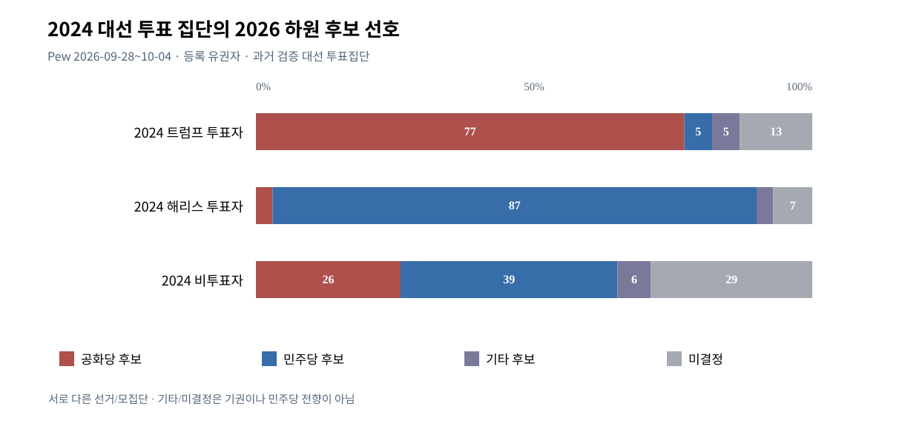
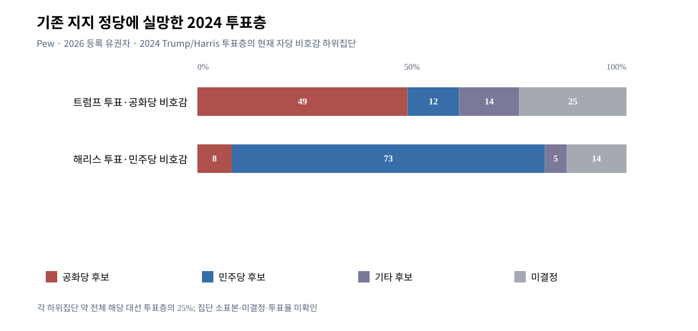
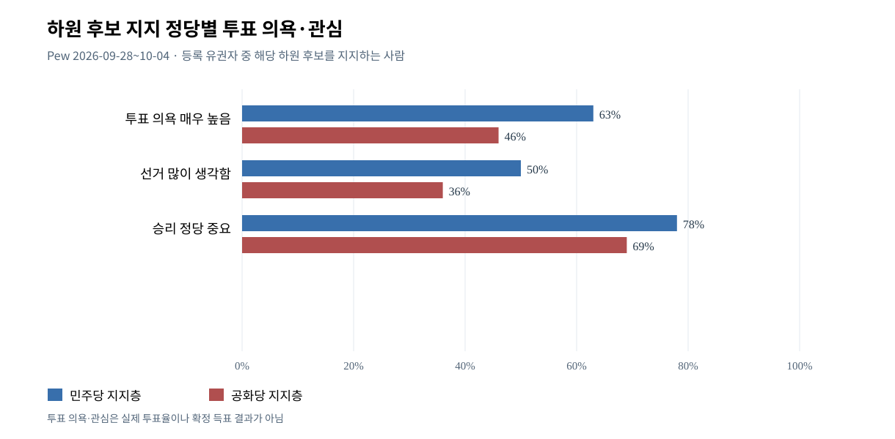

# W5 — 2024 투표연합·무당파·인구집단의 2026 하원 선택·투표 의욕
기준 2026-10-12 KST | 단계: 사용자 승인 W5 첫 본조사. **상태: 핵심 분석 조건부 완료, 집단별 실제 투표전환/기권 인과효과는 미식별**. 본 파일은 개별 W5 증거이며 W6 경합주 연구를 대체하지 않음.

## W5-01 정의와 원자료·방법
- [Pew 2026-10-08 본조사 개요/2024 투표연합](https://www.pewresearch.org/politics/2026/10/08/with-americans-in-a-sour-mood-democratic-voters-are-more-engaged-in-midterms/), [인구집단별 자세한 결과](https://www.pewresearch.org/politics/2026/10/08/midterm-vote-preferences-by-race-and-ethnicity-age-and-other-demographics/), [질문지](https://www.pewresearch.org/wp-content/uploads/sites/20/2026/10/PP_2026.10.8_midterms-economy_questionnaire.pdf), [조사 방법](https://www.pewresearch.org/politics/2026/10/08/midterms-2026-methodology/).
- 필드 2026-09-28~10-04, 미국 성인 n=5,062, 그중 **등록 유권자 n=3,917**. 여기 기록한 하원 후보 선호·투표 관심은 모두 등록유권자 모집단. 다수 선거구에서 실제 후보 이름과 정당 제시했으며 일부 주/단독 후보 선거구는 generic choice 예외. 엄밀히 단순한 전국 익명 generic ballot이 아님.
- 2024년 투표자 검증: 주정부 공식 유권자 기록에서 **2024년 투표했음**이 확인된 성인 시민; 트럼프/해리스 누구에게 투표했는지는 **대선 직후의 자가 설문**. 2024 '비투표'는 당시 투표 적격이었던 비투표자뿐 아니라 당시 적격이 아니었던 2026년 신규 유권자도 포함(2026 조사 모집단은 등록 유권자). **동일 개인의 2024 대선 선택 vs 2026 하원 현재 선호**는 서로 다른 선거; 실제 2026 투표/기권 기록 아님.
- 다른 하위집단(정당, 인구집단)의 계산은 표본크기/MOE가 전체보다 낮아/클 수 있어 작은 1~3%p 차이를 정치적 실제 변화라 단정하지 않음. 집단 인구가중치를 임의로 합산해 선거구 결과로 환산하지 않음.

## W5-02 2024 대선 투표연합 → 2026 하원 선호 (등록 유권자 %)
| 기준집단 | 공화 하원후보 | 민주 하원후보 | 제3·기타 | 미결정 |
|---|---:|---:|---:|---:|
| 2024 Trump 투표자 | 77 | 5 | 5 | 13 |
| 2024 Harris 투표자 | 3 | 87 | 3 | 7 |
| 2024 비투표자(2026 현재 등록) | 26 | 39 | 6 | 29 |
- 트럼프 투표자 중 **23%는 현재 공화 하원후보를 지지한다고 답하지 않았지만**, 그 23%를 민주 후보 지지·투표 기권으로 간주하면 오류. 민주 선호는 5%, 그외/미결정 18%. 해리스 투표자의 민주 하원 지지는 87%.
- [Pew 2026-10] Trump 2024 검증투표층의 현 **대통령 국정 승인율**은 67%, 반대 31%; 2025-02 같은 기준 승인 95%. **국정승인 67%와 하원 공화선호 77%는 질문/행동이 다르므로 직접 동일화 금지**.

[실물 SVG](assets/W5-VIS-F01_2024_coalitions_2026_house.svg) · [원데이터 CSV](assets/W5-VIS-F01_2024_coalitions_2026_house.csv)
- 축: 각 집단 합 100%로 표현한 정규화된 가로 막대, 응답의 **비율**이며 개인 이동 경로 추정 그래프가 아님. 2024 대선후보와 2026 하원 후보 선호를 분리.

## W5-03 2024 연합 중 현재 자신이 지지했던 정당에 불만인 집단
| 대상 (각 2024 대선 투표집단의 약 25%) | 공화 하원 | 민주 하원 | 기타 | 미결정 |
|---|---:|---:|---:|---:|
| Trump2024·공화당 현재 비호감 | 49 | 12 | 14 | 25 |
| Harris2024·민주당 현재 비호감 | 8 | 73 | 5 | 14 |
- 두 하위집단은 표본 규모가 작고, 2024 후보 지지→2026 **다른 선거의** 현재 후보 선호를 묻는 것. 트럼프 연합의 미결정/기타 39%, 해리스 연합 19%. '이탈39%=민주당 이동' 불가.
- 해당 2024 투표층에서 '이번 선거 결과가 정말 중요하다'고 답한 비율: Trump2024 중 공화당 비호감 **36%**, Harris2024 중 민주당 비호감 **65%**. 같은 2024 지지층 내부의 관심 차이 근거이나 실제 기권율은 아님.

[실물 SVG](assets/W5-VIS-F02_disaffected_2024_voters_2026_house.svg) · [원데이터 CSV](assets/W5-VIS-F02_disaffected_2024_voters_2026_house.csv)

## W5-04 2026 등록 유권자 인구집단별 하원 후보 선호
| 집단 | 민주 | 공화 | 기타 | 모름 | 비고 |
|---|---:|---:|---:|---:|---|
| 남성 | 42 | 42 | 4 | 12 | 동률 |
| 여성 | 45 | 31 | 5 | 19 | 민주+14 |
| White 비히스패닉 | 37 | 44 | 4 | 14 | 공화+7 (반올림 합99) |
| Hispanic 모든 인종 | 51 | 24 | 7 | 18 | 민주+27; 나머지25 |
| Black 비히스패닉 | 70 | 7 | 6 | 17 | 민주 우위 |
| Asian 비히스패닉 | 56 | 16 | 5 | 23 | **영어 응답 가능 집단 대표성만 확보** |
| 만18~29세 | 51 | 23 | 4 | 21 | 미결정/기타 ≈25 (반올림) |
| 만30~49세 | 43 | 31 | 6 | 20 | 미결정/기타26 |
| 만50~64세 | 39 | 45 | 4 | 12 | 공화+6 |
| 만65세 이상 | 44 | 41 | 5 | 10 | 민주+3 |
| 대학원 학위 | 58 | 30 | 3 | 9 | 민주 우위 |
| 학사 학위 | 48 | 33 | 4 | 15 | 민주 우위 |
| 일부 대학 교육 | 42 | 38 | 5 | 15 | 근소 |
| 고졸 이하 | 35 | 39 | 6 | 20 | 공화 근소 |
| 정당 무소속/기타 정당 식별 | 40 | 24 | 8 | 27 | 반올림으로 합99; 특정 정당 성향을 선언한 무당파와 다름 |
| 공화·공화 성향 | 6 | 73 | 5 | 15 | 공화 지지. 개별 고정 정당과 leaner 구분 |
| 민주·민주 성향 | 82 | 2 | 3 | 12 | 민주 지지 |
| 공화 성향 무당파만 | 9 | 53 | 9 | 28 | 기타/미결정 합37(원자료 NET38 반올림) |
| 민주 성향 무당파만 | 72 | 3 | 6 | 19 | 선호 성향별 결집 차이 |
- **실제 중요해진 집단**: 여성과 50세 미만, Hispanic 중 등록유권자 선호. 그러나 2024 실제 득표층과 2026 등록유권자 집단을 직접 같은 모수로 비교해 '힐스패닉 2024 Trump 투표가 2026 민주당으로 모두 돌아갔다'라고 단정 불가.
- 2026 전체 Hispanic 등록유권자의 민주 하원 51%·공화24%와 2024 Trump에게 투표한 Hispanic의 Trump **국정승인**57%는 대상이 완전히 다르다.

## W5-05 의욕·투표 이력·실제 11월 투표의 구별
- Pew 2026-10 하원 **민주 후보 지지자 vs 공화 후보 지지자** (등록유권자 중): '투표할 의욕 극도로 높음' 민주 63%·공화46%; 선거 많이 생각함 민주50%·공화36%; '어느 정당 승리 중요한가' 민주78%·공화69%.
- 동일 Pew 등록유권자 중 **2024 실제 투표 이력자** 하원 선호 민주45% 공화39%; **2024+2022 모두 투표 이력자** 민주47% 공화41%; '투표 의욕 극도로 높음' 민주59% 공화35%. 세 모집단은 서로 다른 조건집단; 극도 의욕 지표는 **검증된 실제 투표율이 아님**.
- Reuters/Ipsos 별도 2026-09-30~10-05 관련 Reuters 2026-10-08 보도: **2024 Harris 투표층 48% vs Trump 투표층 30%** '중간선거 투표 매우 열성적'. Ipsos와 Pew의 의욕 문항·집단·언어가 같다고 간주하지 않음.
- Pew 하원 전체 민주44·공화36·기타5·모름15(등록 유권자). Pew 전체 등록유권자 44%는 2026 의회 표를 트럼프 '반대 투표', 19%는 '트럼프 지지 투표'라고 설명(나머지 36% 영향 없음). 민주 후보 지지자 84%는 '트럼프 반대', 공화 후보 지지자는 48%만 '트럼프 지지', 50%는 대통령과 무관. 반대 동기와 투표 선택의 연관은 관측되지만 최종 득표 아님.

[실물 SVG](assets/W5-VIS-F03_congressional_engagement_2026.svg) · [원데이터 CSV](assets/W5-VIS-F03_congressional_engagement_2026.csv)

## W5-06 반례·한계·완료 게이트
1. Trump 투표층의 공화당 하원 지지 77% 및 Trump 국정승인67% 차이 → '대통령에게 불만=민주당에 투표'는 반례로 기각.
2. Harris 투표층 민주당 지지87%, 2024 Trump 투표층 민주당 선호5% → 실제 정당 간 이동보다 민주당 투표층의 강한 결집과 Trump 투표층의 무소속·미결정 문제가 먼저 확인.
3. 정당 성향별 차이가 인종·연령·학력 차이에 의해 혼합될 수 있음. 하위집단 MOE/표본 수는 큰 경우가 있으므로 작은 격차 확정 금지.
4. 2024 비투표층 민주39/공화26이라도 미결정29, 실제 투표율/등록 신규 유권자 구성 알 수 없음. 사전설문으로 투표 기권자의 실제 수를 계산 불가.
5. **실질 완료 범위:** 2024 투표연합 및 집단별 2026 **현재 하원 선택·투표의욕·정당 우호도**의 단면·집단 비대칭을 검증. 2026 선거 실제 전환/기권 **인과·사후 관측 불가능(E)**로 정상 한계.
6. **남은 필수/권장**: 동일 검증투표층의 시간별 민주/공화 투표의향 시계열·각 하위집단 MOE 정밀검증(B), 실제 기권/선거 후 검증(C: 선거 후), 지역별 핵심집단 표심과 상하원 후보별 차이(C: W6). 본조사 조건부 완료를 전체 선거 결과 확정과 혼동 금지.

## W5 주요 원출처
- https://www.pewresearch.org/politics/2026/10/08/with-americans-in-a-sour-mood-democratic-voters-are-more-engaged-in-midterms/
- https://www.pewresearch.org/politics/2026/10/08/midterm-vote-preferences-by-race-and-ethnicity-age-and-other-demographics/
- https://www.pewresearch.org/politics/2026/10/08/midterms-2026-methodology/
- https://www.reuters.com/world/us/trump-voters-are-not-pumped-about-voting-midterms-reutersipsos-poll-finds-2026-10-08/
