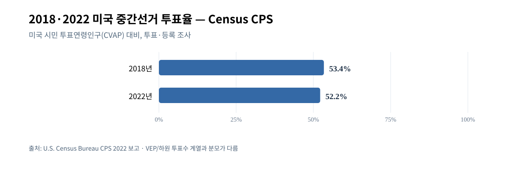
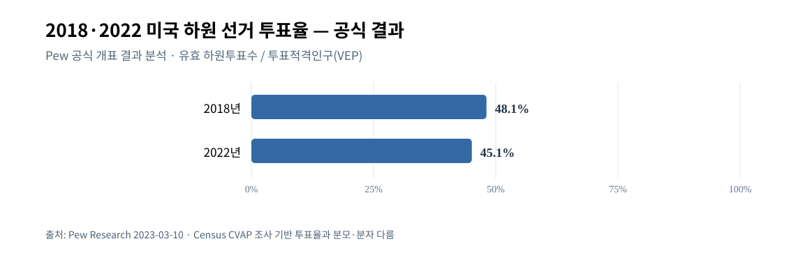

# W5-C — 2018·2022 중간선거 투표율과 2026 참여 의향 비교
기준 2026-10-12 KST. 사용자 승인 2안(C). 실제 역사 투표율과 2026 현재 기대·의향은 별개.

## 동일 정의의 과거 비교
- [미 인구조사국 CPS 2022 선거 요약](https://www.census.gov/newsroom/press-releases/2024/congressional-election-voting-report.html): 시민 투표연령 인구(CVAP)에 대한 조사 기반 투표율 **2018년 53.4%, 2022년 52.2%**. 동일 Census CPS 방법 내 비교만 유효. 2022년 등록률 69.1%.
- [미 인구조사국 2022 조기투표](https://www.census.gov/newsroom/press-releases/2023/2022-voting-registration.html): 모든 실제 투표자 중 **선거일 전 투표 비율** 2018년 **37.8%**→2022년 **47.1%**; **우편투표 비율** 2018년 **23.1%**→2022년 **31.8%**. 조기/우편은 서로 배타적 집단이 아님(우편투표도 조기투표에 포함 가능). 조기투표율이 상승했으므로 최종 turnout이 반드시 증가한다는 뜻 아님.
- [Pew 공식 선거결과 하원 투표율 역사 비교](https://www.pewresearch.org/short-reads/2023/03/10/turnout-in-2022-house-midterms-declined-from-2018-high-final-official-returns-show/): 유효 하원 투표수/투표적격인구(VEP) 기준 **2018년 48.1%, 2022년 45.1%**. Census CVAP와 **분모·투표수·측정방식이 다르므로** 53.4/52.2 계열과 한 선으로 연결 금지.
- [Pew 2022 검증 투표 연구](https://www.pewresearch.org/politics/2023/07/12/republican-gains-in-2022-midterms-driven-mostly-by-turnout-advantage/): 2020년 대통령 투표자 중 2022년 중간선거 참여 **Trump2020 71%, Biden2020 67%**. 2022년 공화당 전국 하원표 우세의 대부분은 정당변경보다 *참여 집단 구성 차이*와 관련. 이는 2026년 이전 사례이며 Trump2024 vs Harris2024의 **실제 2026 기권율**이 아님.
- [Pew 2026-10 현재 의욕](https://www.pewresearch.org/politics/2026/10/08/with-americans-in-a-sour-mood-democratic-voters-are-more-engaged-in-midterms/): 민주당 하원 후보 지지자 극도 의욕63%, 공화 후보 지지자46%. Pew 2022 검증 역사 집단 실제 참여(2020→2022)와 시점/질문 다른 지표. Reuters/Ipsos 2026의 Trump/Harris2024 응답 의욕 30/48 역시 실현율 아님.

## 그림 및 원자료

[CSV](assets/W5C-VIS-F01_census_midterm_citizen_turnout_2018_2022.csv) · [SVG](assets/W5C-VIS-F01_census_midterm_citizen_turnout_2018_2022.svg)

[CSV](assets/W5C-VIS-F02_pew_house_vote_turnout_2018_2022.csv) · [SVG](assets/W5C-VIS-F02_pew_house_vote_turnout_2018_2022.svg)
- CSV/SVG는 실제 기록으로 재생성한 것이며 원 과거 ChatGPT UI 픽셀과 같다는 주장이 아님. 2026년 조기투표 현황을 전국 단일 정확한 합산으로 만들지 않음: 주별 시작일/데이터 집계·선거방식 차이 확인 전은 해당 결과 **UNKNOWN**.

## 해석/반례/남은 검증
- **강한 역사적 반례**: 2022년은 대통령 전·현직 특정 인물에 대한 전국 평가의 단순 계수가 아니라, 누가 실제로 투표하는지에 따라 양당 상대 성과가 달라졌음.
- 2026년 민주 지지층의 높은 현재 의욕이 2018년의 실제 참여율 수준을 재현한다는 **근거는 없음**.
- **조건부 완료**: 서로 다른 2가지 과거 참여율 계열, 조기·우편의 겹침, 2022 정당별 참여 차이를 확립. 선거 전 전국 실제 2026 turnout 비교는 불가능하므로 보류(E).
