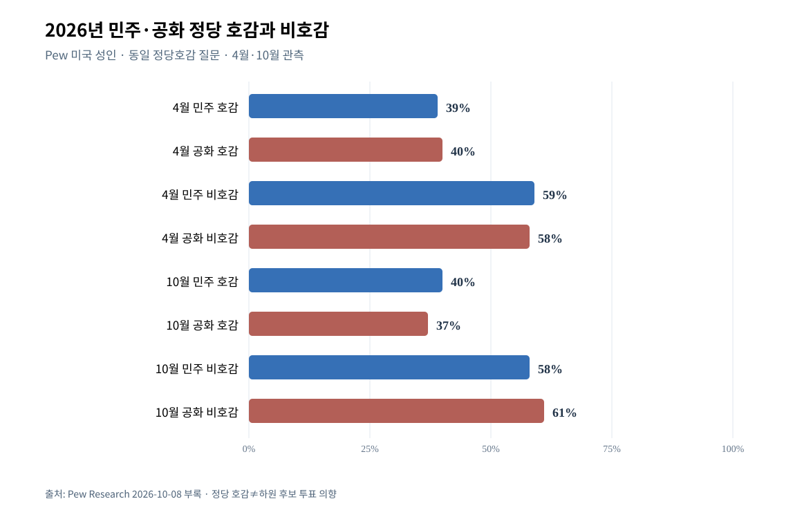

# W5/W6-E — 2026 민주당 자체 호감·대안 경쟁력 vs 반트럼프 투표
기준 2026-10-12. 사용자 승인 2안(E). **정당 호감도와 하원 실제 후보 선호, 대통령에 대한 국정 승인 질문을 구분**.

## 같은 기관/문항 시계열·비교
- [Pew 2026-10-08 부록 원자료](https://www.pewresearch.org/politics/2026/10/08/midterms-2026-appendix-additional-charts/), 미국 **성인** 전체의 정당에 대한 호/비호감: 2026-04-28 민주 긍정39/부정59, 공화 긍정40/부정58; 2026-10-04 민주 긍정40/부정58, 공화 긍정37/부정61. **2026-10 기준 민주·공화 모두 과반 비호감**, 민주당의 2026 상반기 대비 강한 대중 호감도 상승이라는 근거 없음.
- [Pew 2026-10-08 메인 결과](https://www.pewresearch.org/politics/2026/10/08/with-americans-in-a-sour-mood-democratic-voters-are-more-engaged-in-midterms/): 등록유권자 실제 지역 하원 후보 민주44/공화36. 정당 자체 호감도(전체 성인 민주40/공화37)와 **분모·종속변수가 다른 것**으로 합쳐서 '민주당 호감40%=득표40%'라고 해석 금지.
- [Cook 2026-09 경쟁하원 LV](https://www.cookpolitical.com/analysis/survey-research/battleground-district-project/new-battleground-district-poll-shows): 경쟁 선거구의 의회 민주당/공화당에 대한 호감 **양쪽 모두 긍정41·부정56**. **하원 후보 선택 민주49·공화47**과 같은 프로젝트여도 정당의 '의회 내 호감'과 '하원 후보 투표'는 서로 다른 질문. '민주당 자체가 매우 인기라서 승리한다'보다 양당에 대한 부정·정권 견제 성격 해석에 더 잘 부합하지만 **개인별 동기의 인과 비중은 추가 분석 없이는 모름**.
- [Pew 2026-10 정치적 의미](https://www.pewresearch.org/politics/2026/10/08/with-americans-in-a-sour-mood-democratic-voters-are-more-engaged-in-midterms/): 등록 유권자의 44%는 자신의 하원 투표가 트럼프 **반대**를 위한 것이라고 답함, 19%는 트럼프 **지지**로 표현. 트럼프 반대동기와 민주당의 당론/후보에 대한 적극 지지를 동일시하지 않는다.
- Cook 가상 후보 유형 정당 표지 효과: **주류 공화 후보54/민주사회주의46**, **MAGA 공화48/민주사회주의52**, 경합 37개 지역 LV. 상대 후보가 동일한 이념표지여도 공화 후보를 묘사하는 문구가 달라져 평가가 달라지는 **가상 질문**; 실제 특정 선거구 투표여론으로 간주 금지.

## 그래프

[CSV](assets/W5E-VIS-F01_party_favorability_2026.csv) · [SVG](assets/W5E-VIS-F01_party_favorability_2026.svg)
- 동일 Pew 성인 질문 2026년 4월/10월 정당 긍정/부정 8개 관측값. 축 0~100%, 한 점수로 다른 집단 정의/다른 질문과 합성하지 않음.

## 반례와 조건부 판정
- **민주당의 조직·정책대안에 대한 보편적 열광의 증거는 약함**: 주요 민주 선호에도 민주당 자체 부정평가58% 및 경합지 양당 56% 부정. 과도하게 '미국이 민주당 정책으로 전향'이라고 할 수 없음.
- 그러나 민주당 후보 선호 44%와 후보별 선호 격차는 실존하므로 **양당 모두 비호감=민주당이 승리할 수 없음**도 오류.
- **B 잔여**: 민주당 구체 정책 공약별 직접 찬반과 후보 호감/정책성과·정당 의제신뢰의 동일기관 반복표. 선거 전 무작위 실험/동일개인 패널 없이 '반트럼프 표가 민주로 간 인과 몫' 추정 불가.
