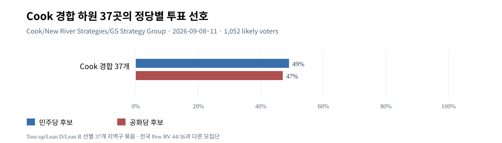
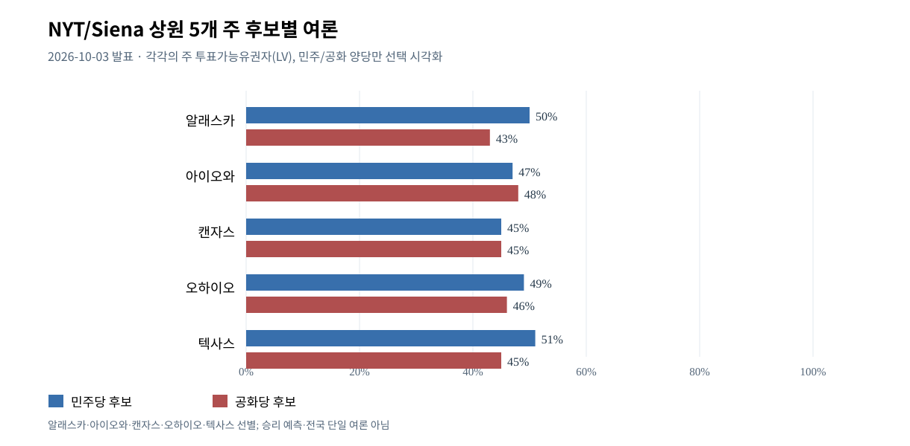

# W6 — 2026 중간선거 전국 하원·경합 선거구·상원 주별 후보 여론
기준일 2026-10-12 KST; 2026-11-03 선거는 미래. 상태: **본조사 1차: 핵심 전국·경합지역/상원 표본 조사 완료, 조건부 완료**, 지역구 435곳 전수조사/선거 후 결과 미완료. 정당 우세와 실제 의석·예측 확률 분리. 원자료의 선정·누락은 정직하게 명시.

## W6-01 전국 하원 정당·후보 선호 vs 경합 하원 선거구
1. [Pew 2026-10-08](https://www.pewresearch.org/politics/2026/10/08/with-americans-in-a-sour-mood-democratic-voters-are-more-engaged-in-midterms/): 2026-09-28~10-04 n=3,917 **등록유권자(RV)**, 자신이 사는 지역구 하원 후보 선호 **민주44%, 공화36%, 기타5%, 미결정15%**. 대부분 지역구에서 실제 하원 후보명/정당 제시; 일부 주/상대당 출마하지 않는 곳의 익명당 후보 예외. 명칭상 단순 전국 anonymous generic-ballot과 다름.
2. [Reuters/Ipsos 2026-10-05](https://www.ipsos.com/en-us/reutersipsos-october-survey), [Reuters 보도](https://www.reuters.com/world/us/trump-approval-record-low-hispanic-voters-sour-on-republicans-reutersipsos-poll-2026-10-05/): 하원 선호 **민주44%·공화37%**, 등록유권자에 한함. 국정 승인32%는 미국 성인; 이 둘은 모집단 다름.
3. [Cook Battleground District Project](https://www.cookpolitical.com/survey-research/2026-battleground-district-project) 및 [2026-09-17 원문해설](https://www.cookpolitical.com/analysis/survey-research/battleground-district-project/new-battleground-district-poll-shows): 2026-09-08~11 **투표가능 유권자(LV) n=1,052**, Cook가 Toss Up/Lean R/Lean D로 분류한 **37개 지역구 선별**, 양당 계열 **민주49%·공화47%**; 조사 지역구들의 2024 트럼프 대통령 선호 평균 +5%p. 본 집합 Trump 2026 국정승인42, 반대58. SMS-to-web·온라인 패널, MoE ±3.02%p, 양당 소속 리서치 기관(New River Strategies D + GS Strategy Group R) 공동 참여. 2024 대선과 2026 하원 후보 선호는 다른 선거이므로 +5→D+2의 '7%p 변동'은 분석적 비교이지 동일 후보/개인의 직접 이동량 아님.
4. Cook 2026-04 비슷한 프로젝트는 **36개 지역구**(9월 37개와 구성이 다름) 민주50·공화44. **이를 같은 지역구패널의 6p→2p 후퇴로 직접 해석 금지**. 여름동안 경합지 분류가 재편되어 트럼프 강세 선거구 추가. 조사 대상의 구성/통계 방식이 변한 셈.

[SVG](assets/W6-VIS-F02_cook_37_battleground_house_2026.svg) · [CSV](assets/W6-VIS-F02_cook_37_battleground_house_2026.csv)
5. [Cook 2026-10-09 18곳 판정 변경](https://www.cookpolitical.com/analysis/house/house-overview/eighteen-more-house-race-ratings-move-democrats-favor): 18개 하원 경합·잠재 경합지역의 전문분석 등급을 민주에 유리하게 조정, 그중 4 GOP 현역 지역 Toss Up→Lean D, 또 다른 4 Lean R→Toss Up 등. Cook의 **전망**에서는 민주당 순증 **9~19석**, 민주당 전체 **224~234석**이라는 중심 구간 제시. 전망은 통계 조사 개별 결과와 구별해야 하고 실현된 결과가 아님.
6. [Cook 선거구 집계 분석](https://www.cookpolitical.com/analysis/survey-research/battleground-district-project/new-battleground-district-poll-shows): 경합지역 응답에서 **주요 쟁점 대응 정당의 차이** 민주 경제 +7p, 인플레이션 +8p, 휘발유 가격 +12p, 관세/무역 +9p, 정치 부패 +7p. 공화 **이민 +5p**. 이것은 **쟁점별 정당 선호**이며 투표득표율이 아님. 중동/관세의 체감 경제 경로(W2/W3) 및 ICE/이민정책(W4)의 상대 이점과 연관되지만 독립 인과 기여 미식별.
7. Cook 조사에서 **43%는 트럼프에 대한 견제만이 아니라 정치시스템 변경에 집중하는 후보를 선호**(무당파 중 59%). 양당 연방의회 모두 호감41·비호감56; 민주당에 대한 열광보다는 체제 불만/정부 반대 심리 설명. 반례: 일반 공화당 후보 vs 민주사회주의자 가상대결 **R54/D46**, MAGA 후보 vs 민주사회주의자 **D52/R48**. 극단/후보 유형과 지역 맥락이 결과를 바꿀 수 있음.

## W6-02 구체 선거구 사례(후보 개인효과)
- [Siena 2026-10-09 NY-21 발표](https://sri.siena.edu/2026/10/09/times-union-wptz-nbc5-wamc-siena-poll-of-likely-ny-21-voters/): 필드 2026-09-30~10-06, **NY 21구 LV n=496**. 실제 하원 후보 **Blake Gendebien (D) 46% · Anthony Constantino (R) 42% · Christopher Schmidt (I) 5% · 미결정8%**(반올림 합계101%). 동일 응답자 중 하원 장악 정당 선호 **R50/D45**; 지사선거에서 **R Bruce Blakeman55/D Kathy Hochul40**. 후보 개인/현장 인지도와 전국 '반트럼프'가 다른 선거선택 양상을 낳는 사례.
- 같은 NY-21 무당파 하원 후보 **Gendebien51% · Constantino30%**, 여성에서는 민주 후보 +18p·남성에서는 공화 후보 +10p(후보 개인차). **2026 투표일에 실제 'NY21 민주 승리' 확정 금지**.
- [AP 2026-10-09](https://apnews.com/article/c87c09149f0d5fe329f78bc73901a8dd): 공화당이 민주당 보유 지역 NH-1, NY-4, OH-1, NV-3, NM-2를 공략. 이는 민주당 전국 우세가 모든 지역 후보에게 일방적 우세를 의미하지 않는 반례.
- [Reuters 2026-10-10 DCCC 공략](https://www.reuters.com/world/us/midterm-strategy-driving-democrats-deep-into-trump-country-2026-10-10/): 민주당 캠프의 66곳 GOP 보유 지역 확대 목표는 **전략적 타깃 선별**이며 66곳이 모두 toss-up이나 민주당 지지율 우세로 실측됐다는 뜻 아님.
- [WaPo 2026-10-11 CO-8 유권자 인터뷰](https://www.washingtonpost.com/politics/interactive/2026/10/11/these-are-voters-who-will-decide-midterm-elections/): 공화 현역 Gabe Evans와 민주 도전자 Manny Rutinel, 의료비·국경·원유 일자리 등 정치 관심이 교차. 이 인터뷰는 **정성 사례**이며 집단 대표 표본/투표율 수치 아님.

## W6-03 상원 구조·공통 동질 조사
- 상원 현 재적 구성 **공화53, 민주·민주계 무소속47** (2026-10-12 자료). 공화당 부통령의 동률 결정권 고려, 민주당이 51석 확보하려면 현 기준 **순증4석** 필요. 이번에 모든 상원이 선출되는 것이 아니고 35석(정기33+보궐2)만 투표 대상. 주별 선거구성·후보·경제/당파 지형 때문에 전국 하원 R/D 투표 선호로 상원 의석 계산 불가.
- [NYT/Siena Poll of Likely Voters—Senate Races, 공개 2026-10-03](https://sri.siena.edu/2026/10/03/nytimes-siena-poll-of-likely-voters-senate-races/). **5개 주 별도 LV 표본 조사**, 동일 조사 프로젝트에서 선별한 주들이지 미 전역 상원 평균 아님. 발표 본문 확인:
| 주·현재 의석 | 민주 후보 | 민주 % | 공화 후보 | 공화 % | 기타 확인 |
|---|---|---:|---|---:|---|
| Alaska (R) | Mary Peltola | 50 | Dan Sullivan | 43 | R 측 불리하나 조사상 확정 아님 |
| Iowa (R) | Josh Turek | 47 | Ashley Hinson | 48 | R +1, 표본오차보다 작은 차이 |
| Kansas (R) | Adam Hamilton(보도 일부 원문 Hamilton 오자 포함) | 45 | Roger Marshall | 45 | Libertarian David Graham 3%; 오자/철자 정본 재검토 필요 |
| Ohio special (R) | Sherrod Brown | 49 | Jon Husted | 46 | D+3, 향후 여론 변화 가능 |
| Texas (R) | James Talarico | 51 | Ken Paxton | 45 | D+6, 주 전체 LV와 개별 지역/계층은 다름 |
- Siena 공개글은 인쇄된 후보 이름 중 **'Adam Hamiliton' 오탈자**가 나타나므로 이 W-ID에서는 일반적으로 확인되는 **Adam Hamilton**을 쓰되, 확정 공식 후보명은 주 선관위 자료로 최종 재검증할 것. 이 근거만으로 타당성 없는 철자 확정을 하지 않음.

[SVG](assets/W6-VIS-F01_siena_senate_five_states_2026.svg) · [CSV](assets/W6-VIS-F01_siena_senate_five_states_2026.csv)
- 그 밖의 중요 LV·개별 조사(기관·필드 및 방법 서로 달라 일관된 '주별 우세 순위' 아님):
  - [North Carolina: East Carolina University 2026-09-30~10-03 (RCP 재인용)](https://www.realclearpolling.com/polls/senate/general/2026/north-carolina/cooper-vs-whatley): Roy Cooper D50 vs Michael Whatley R43(반올림 정수). The Hill/DDHQ에 세부값 Cooper49.5/Whatley42.8; n=810 LV. **표본/문항 원문과 반올림 소수 비교** 추가 가능.
  - [Maine: Washington Post/GMU Schar 2026-09-30~10-05](https://www.washingtonpost.com/politics/2026/10/09/poll-democrat-troy-jackson-narrowly-leads-susan-collins-maine-senate-race/): LV n=800, Troy Jackson D50 vs Susan Collins R46, ±3.6%p 전체 MoE. 같은 후보 차이4p가 오차 구간과 겹침; 후보 차이의 정확한 paired CI는 별도 설계 검증 필요. Collins 현역 이점·연방자금 조달 및 트럼프와의 거리두기 vs 의료·낙태·생활비 쟁점의 경쟁.
  - [Georgia: Trafalgar 2026-10-07~09, RCP 목록](https://www.realclearpolling.com/polls/senate/general/2026/georgia/ossoff-vs-collins): Jon Ossoff D51 vs Mike Collins R43. [Georgia 전체 조사기관 평균 목록](https://www.realclearpolling.com/elections/senate/2026/georgia)에는 여러 민주당 우세 관측이지만 이것이 결과 확정 아님.
  - [Michigan: 2026-10-07 Axios 후보 해설](https://www.axios.com/local/detroit/2026/10/07/senate-race-1-minute-voter-guide-2026): Abdul El-Sayed D vs Mike Rogers R. 양당 경쟁 지속. 단일 비교표에 특정 조사 숫자를 넣으려면 해당 조사 **원문·필드·LV/RV** 별도 확보 필요하므로 이 시점 W-ID에는 숫자를 창작해 넣지 않음.
- [Cook 2026-10-06 상원 판정 업데이트 요약](https://www.washingtonpost.com/politics/2026/10/06/three-senate-races-shift-toward-democrats-cook-ratings/): Kansas Lean R→Toss Up; New Hampshire Toss Up→Lean D; North Carolina Lean D→Likely D. 이는 **분석가 전망등급 변경**이지 해당 날짜 실시된 새로운 유권자 조사값 아님.

## W6-04 하원·상원 여론 차이와 국가경제/이란 전쟁 연계
- W2·W3: 2025~2026 CPI·EIA 가격 실측과 유권자들의 경제·전쟁 생활비 책임 인식. W4: Cook 경쟁하원에서 민주당의 경제·에너지 우위, 공화당의 이민 이슈 우위. 각 원인 이슈와 개별 주/선거구 투표선호 간 교차상관 가능.
- W5: 2024 Trump 투표층 현재 House GOP 선호77% vs Harris 투표층 DEM87%, 의욕 높은 응답의 민주 집중; 전국 평균뿐 아니라 경합지에서도 주목. **그 이유·투표 실현율·지역 후보 개인효과는 아직 분리 불가**.
- Senate: Alaska/Texas/Ohio/Kansas/Iowa 등 일부 공화당 보유주의 LV 개별 조사에서 민주당이 의외로 경쟁력; 그러나 상원 승패에 대한 합산 확률·동시 오차구조·자금·현역효과·조기투표와 실제 결과를 모델링하지 않았으므로 '상원 민주 확정' 표현 금지.
- House: Cook 경합지역 37곳 선정에 2024 Trump 강세지역이 신규 편입. 4월 36곳과 9월 37곳 비교 때 **집합 변화에 의한 구성 효과(selection bias)** 존재. 주별 재획정(redistricting) 지역구 경계 변화와 분석가 등급 변경을 각 후보 지지율의 직접 변동이라 하지 않음.
- **단기 급변 사건**: 이란·유가·경제통계·2026-10 법원/외교 변화가 조사 필드 후에 발생했을 수 있으므로 선거 당일까지 여론 미반영 가능. 정치보도·후보 사건도 지역별 다를 수 있음.

## W6-05 반례·필수 한계·상태
1. 민주당 전국 하원 +8p(RV) ≠ 하원 8%p 득표 차이나 의석 자동 순증; 37곳 +2p(LV) ≠ 37개구 각 민주당 +2p; Cook +9~19 의석은 예측모델·전문가 평가로 실제 선거 결과 아님.
2. NY-21 민주 실제후보 +4p와 동시 공화 의회 장악 선호+5p의 충돌이 후보 개인효과/하향 투표의 구체적 반례.
3. 공화 현역/민주 후보 차이 주별로 다르고 일부 근소·동률: 국가적 민주 우세가 보편적인 지역 승리 보증은 아님.
4. 2024 Trump 실제 투표층 이동·기권은 2026 사전 RV 설문만으로 식별 불가. LV 표본 역시 실제 최종 참여층과 다름.
5. **조건부 완료 범위**: 전국 RV → 경쟁 House 37곳 LV → 대표 NY-21 LV → Siena Senate 5주 LV 및 일부 주별 독립 조사로 의회의 여론이 구조적으로 다르다는 것을 비교·반례와 검증. 하원 435개 선거구 전수와 상원 전체주 최신 동일 기관 시점별 자료·후보별 집단/자금 변수를 완결했다는 뜻은 아님.
6. **후속 권장**: Cook 10월 최신 경합등급 세부목록 PDF/추가 개별하원 district poll, Sena 주별 NYT/Siena 각 topline sample/MoE, NC/GA 독립 폴스터 문항 원본, 2026 추후 선거후 turnout 비교. 핵심 해석을 변경하는 새 증거가 생기면 해당 W-ID 국소 재검증.

## 중요 출처
- https://www.pewresearch.org/politics/2026/10/08/with-americans-in-a-sour-mood-democratic-voters-are-more-engaged-in-midterms/
- https://www.cookpolitical.com/survey-research/2026-battleground-district-project
- https://www.cookpolitical.com/analysis/survey-research/battleground-district-project/new-battleground-district-poll-shows
- https://www.cookpolitical.com/analysis/house/house-overview/eighteen-more-house-race-ratings-move-democrats-favor
- https://sri.siena.edu/2026/10/03/nytimes-siena-poll-of-likely-voters-senate-races/
- https://sri.siena.edu/2026/10/09/times-union-wptz-nbc5-wamc-siena-poll-of-likely-ny-21-voters/
- https://www.washingtonpost.com/politics/2026/10/09/poll-democrat-troy-jackson-narrowly-leads-susan-collins-maine-senate-race/
- https://www.realclearpolling.com/polls/senate/general/2026/north-carolina/cooper-vs-whatley
- https://www.realclearpolling.com/polls/senate/general/2026/georgia/ossoff-vs-collins
