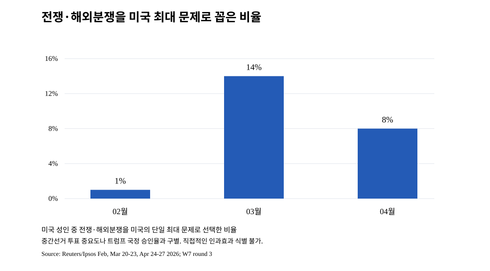

# W7 3차 보완 — 2026년 전쟁 이슈 현저성과 국정 평가의 분리, 인과감사
기준일 2026-10-11 KST, W1/W2 제3차 보완 근거에 연결. `W3_W7_EVENT_CAUSAL_REVIEW.md`는 유지.

## 현저성의 직접 관측(Reuters/Ipsos Core Political, 미국 성인)
- 이란 전쟁 전 2026-02 **전쟁·해외분쟁을 미국의 가장 중요한 문제로 지목 1%**. 2026-03-20~23에는 **14%**. 같은 3월 설문에서 경제·일자리 문제 16%, 전쟁 찬성 35% 반대 61%, 트럼프 국정 승인 36%.
- 2026-04-24~27 전쟁/외국 분쟁 최우선 문제 **8%** (3월 14%에서 하락), 경제관련 최우선 문제 20%(3월 16%에서 상승). 해당 4월 트럼프 국정 승인34%, 경제 대응 승인27%, 인플레이션 대응 승인21%.
- 출처: [Ipsos March Reuters/Ipsos Core](https://www.ipsos.com/en-us/economy-and-foreign-conflicts-now-publics-top-two-issue-concerns), [Ipsos April Reuters/Ipsos Core](https://www.ipsos.com/en-us/americans-increasingly-feel-economy-wrong-track).
- **정의 구분**: 이 비율은 단일 응답의 '미국 최대 국가 문제'이고, Chicago Council 2026-07의 '중간선거 최우선 투표 문제(이란전쟁 2%)' 및 Pew의 '매우 중요한 투표 문제'와 별개의 설문.

## 국가경제·체감 경로와의 시차 대조
| 날짜 | 객관/여론 관측 | 해석 |
|---|---|---|
| 2026-02, 전쟁 전 | Reuters/Ipsos 국정 38%, 해외분쟁 최대문제 1% | 이전부터 존재하는 국정 불만 |
| 2026-03 | 해외분쟁 최대문제 14%, 국정 36%, EIA 주유소 가격 급등 | 전쟁 현저성 급등과 지지율 2p 차이. 2p가 전쟁 인과효과라 할 수 없음 |
| 2026-04 | 해외분쟁 최대문제 8%, 경제 최대문제 20%, 국정 34% | 전쟁 현저성은 떨어졌지만 국정 승인 및 경제 승인은 낮음. 경제 귀인 이외 내정/일반 지지 침식 가능 |
| 2026-07 | 국정 승인 37%(한 Ipsos Core 관측) | 전쟁 중 지지율 단조감소 가설 반례 |
| 2026-08~10 | Ipsos 국정 33→32→32%; BEA 8월 실질 DPI 정체, 모기지 10월 7.40%, CPI 8월 yoy 3.4% | 생활비 부담·정치적 불신 공존, 사건별 독립 영향의 정량 분해 불가 |

## 경쟁 설명 감사
1. **전쟁 단일원인 가설 기각(전 기간 설명으로는 불충분):** 2025~26-02 이전 장기 국정 하락이 존재. 이후 지지율 2026-07 반등, 해외분쟁 이슈 3→4월 하락.
2. **전쟁이 가격 경로로 추가 부담을 주었다는 설명:** EIA 주유소 전쟁 전 ~$2.94→5월 ~$4.50, BLS CPI yoy 2월2.4→5월4.2, 생활비 정책 승인 낮음. 그러나 전쟁 없었을 기초 경기·휘발유 계절가격 및 유가 다중요인이 통제되지 않음.
3. **관세를 통한 상품가격 영향:** NY Fed 소비재 가격모형의 긍정적인 효과추정이 있으나 소비재 한정, 모기지율·전체 CPI·국정 승인 %p 전환 불가.
4. **금리·주거 부담:** 주거비 CPI의 완만한 상승 3.0%와 신규 모기지금리 7.40% 공존; 신규매수자와 기존 고정금리 보유자는 크게 다름. 금융시장은 재정·통화·국제 충격 등 다수 원인.
5. **산업별 경제 체감:** 제조업 2025-12 저점 이후 +72k 고용은 전면 제조업 붕괴설의 반례; 실질 DPI 0%, 실질 소비+0.6%는 가계 수요 유지가 곧 부담 부재가 아님을 보여줌.
6. **정치/행정 요인:** 이민 집행/사법·부패·민주주의 문제의 높은 의제 중요도와 2026년 겨울 ICE 논란 등 W4 필요. '전쟁이 없더라도 지지율이 낮아졌을 수 있다' 경쟁 설명 포함.
7. **정치적 책임귀속과 응답자 구성:** 유권자가 가격 인상의 책임을 트럼프 정책에 돌리는 설문(Reuters 2026-10-09 보도)과 객관 가격의 인과기여율은 같지 않음. 설문 원질문 및 모집단 별개 확인 후만 정량 귀인 인용.

## 판정할 수 없는 항목과 권고
- 차분/회귀 분석으로 트럼프 승인율의 '전쟁/관세/주거/이민' 인과기여 %p를 나눌 데이터·독립 교란 통제가 없음. 무리한 시계열 상관계수 출력 금지(표본n=10, 다중자기상관·사건 공선성).
- 앞으로는 W3 중국/우크라이나/동맹과 W4 내정요인을 확장해 경제 단일설명을 도전한 뒤, 사건별 여론 미시자료를 확보하면 모형 분석 여부를 재판정할 것.

## W7-VIS-F01 그래프 근거·시각 정보 보존 (2026-10-11)
- 그래프: 2026 Reuters/Ipsos 국가 '가장 중요한 문제' 선택 질문에서 해외분쟁/전쟁 비율(미국 성인): 2월 1%, 3월 14%, 4월 8%. X=2026-02,03,04의 필드 종료월, Y=0~16%, 단위=응답비율(%), 막대 영점 기준; 전체 응답자 대비 단일 최우선 응답. 원출처 위 Ipsos 3월·4월 조사 문항 및 수치. 세 포인트 1/14/8는 앞선 채팅 표시 차트와 수치 일치. 과거 UI 실제 픽셀·도구팁은 별도 획득하지 못함(UNKNOWN).
- 별개 모집단/문항인 Chicago Council 2026-07 '중간선거에서 전쟁이 한 가지 최우선 문제' 2%, Pew 2026-10 '경제가 매우 중요' 84%는 같은 차트에 중첩 금지. 2월 1→3월 14→4월 8의 변화만으로 트럼프 국정 승인 38→36→34의 인과효과를 측정했다고 주장 금지.
- 2026-08의 실질 DPI 0.0·real PCE +0.6, 모기지 7.40, 제조업 최근 저점 대비 +72k는 모두 정책 인과효과가 아닌 독립된 관측이므로 국제·국내 요인의 대안 해석을 제거하는 증거로 단독 사용하지 않음.

### W7-VIS-F01 실제 시각자료 보존 (2026-10-11)

- [SVG 그래프](assets/W7-VIS-F01_war_issue_salience_2026.svg) · [CSV 원데이터](assets/W7-VIS-F01_war_issue_salience_2026.csv); 2026년 2/3/4월: 1/14/8%. 원출처와 질문 구분은 위 본문 참조.
- 과거 ChatGPT UI 그림의 실제 픽셀을 추출한 자료가 아니라 연구 수치·비교 관계로 재생성한 SVG이다. 과거 UI 원형 동일 여부 UNKNOWN.
- 최종보고서: 전쟁 관심도의 변화 W7 중요 시각자료 편입 후보. 트럼프 지지율 변화의 인과효과로 해석하지 않음.
